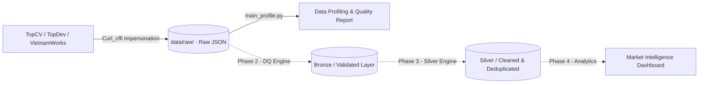

# IT Job Market Intelligence 🚀

Hệ thống thu thập, kiểm kê chất lượng và phân tích dữ liệu thị trường việc làm Công nghệ Thông tin (IT) tại Việt Nam theo kiến trúc **Data Engineering & Market Intelligence** hiện đại.

---

## 📑 Kiến Trúc Tài Liệu Phân Tầng (Modular Documentation)

Để mã nguồn dễ đọc, dễ bảo trì và tiện mở rộng, tài liệu kỹ thuật chi tiết đã được phân bổ trực tiếp vào từng module:

| Phân hệ / Thư mục | Tài liệu chi tiết | Nhiệm vụ chính |
| :--- | :--- | :--- |
| **`src/crawlers/`** | [📖 Tài liệu Web Crawlers](src/crawlers/README.md) | Thu thập dữ liệu từ TopCV, TopDev, VietnamWorks; vượt Cloudflare WAF; quản lý hàng đợi pending. |
| **`src/profiling/`** | [📖 Tài liệu Data Profiling](src/profiling/README.md) | Kiểm kê kho dữ liệu, đo tỷ lệ thiếu (missing), phân tích ngôn ngữ (`vi`/`en`/`mixed`), so sánh schema. |
| **`tests/`** | [📖 Tài liệu Test Suite](tests/README.md) | Bộ kiểm thử tự động Pytest, cơ chế Sandbox Output cô lập không làm bẩn dữ liệu raw. |
| **`reports/`** | [📋 Báo cáo Profiling Master](reports/profiling/latest_summary.md) | Báo cáo cập nhật tình trạng dữ liệu thô và lịch sử chỉ số chất lượng (`history_metrics.csv`). |

---

## 🏛️ Kiến Trúc Luồng Dữ Liệu (Data Pipeline)

Hệ thống được thiết kế theo tư duy **Medallion Architecture**:



1. **Raw Ingestion Layer (Đang hoạt động)**:
   - Thu thập và lưu trữ dữ liệu gốc bất biến (Immutable Raw JSON) phân chia theo ngày `YYYY-MM-DD`.
   - Lưu trữ 2 tầng: `listings/` (sổ theo dõi trạng thái `pending`, `success`, `failed`) và `details/` (dữ liệu chi tiết đã validate).
2. **Data Profiling & Quality Layer (Đang hoạt động)**:
   - Quét kiểm kê toàn bộ kho raw: tỷ lệ hoàn thiện các trường, phân bố mức lương, tỷ lệ ngôn ngữ, phát hiện trùng lặp chéo sàn.
3. **Data Quality Validator & Silver Layer (Kế hoạch tiếp theo)**:
   - Rule Engine phân tách bản ghi: `valid`, `invalid`, `quarantine`.
   - Chuẩn hóa khoảng lương về VNĐ, khử trùng lặp chéo (Entity Resolution).

---

## 🚀 Hướng Dẫn Nhanh (Quickstart)

### 1. Cài đặt môi trường

```powershell
# Tạo và kích hoạt môi trường ảo
python -m venv .venv
.\.venv\Scripts\Activate.ps1

# Cài đặt thư viện phụ thuộc
pip install -r requirements.txt
```

### 2. Thu thập dữ liệu việc làm (`main_crawl.py`)

```powershell
# Cào tự động cả 3 nguồn (mỗi nguồn 100 jobs thành công)
python main_crawl.py --source all --target 100

# Cào riêng từng nguồn (ví dụ 50 jobs TopCV)
python main_crawl.py --source topcv --target 50

# Chế độ cào bù các job bị lỗi trước đó
python main_crawl.py --source all --retry-failed
```

### 3. Kiểm kê và đo lường chất lượng dữ liệu (`main_profile.py`)

```powershell
# Quét kiểm kê toàn bộ kho dữ liệu từ trước đến nay
python main_profile.py

# Chỉ kiểm kê ngày cào mới nhất
python main_profile.py --latest
```

### 4. Chạy kiểm thử tự động (`pytest`)

```powershell
# Chạy toàn bộ test suite (11/11 tests)
pytest tests -v
```

---

## 📁 Cấu Trúc Tổng Thể Dự Án

```text
IT-Job-Market-Intelligence/
├── configs/
│   └── sources.yaml              # Cấu hình endpoint, headers, rate-limit các web
├── data/
│   └── raw/                      # Kho dữ liệu thô (topcv, topdev, vietnamworks)
├── logs/                         # Ghi log tập trung (Ignored by Git)
├── reports/
│   └── profiling/                # Báo cáo chất lượng dữ liệu (latest_summary.md, history_metrics.csv)
├── src/
│   ├── crawlers/                 # Mã nguồn thu thập dữ liệu (TopCV, TopDev, VietnamWorks)
│   ├── profiling/                # Module kiểm kê và đo lường chất lượng dữ liệu
│   └── schemas/                  # Pydantic schema chuẩn hóa JobListingRaw, JobDetailRaw
├── tests/                        # Bộ kiểm thử tự động Pytest (Unit & Integration)
├── main_crawl.py                 # CLI điều phối cào dữ liệu
├── main_profile.py               # CLI kiểm kê và profiling dữ liệu
├── requirements.txt              # Danh sách thư viện phụ thuộc
└── README.md                     # Tài liệu tổng quan dự án
```

---

## 🗺️ Lộ Trình Phát Triển Tiếp Theo

- [x] **Phase 1: Ingestion & Crawlers**: Hoàn thành TopCV, TopDev, VietnamWorks với WAF bypass, pending queue, smart stop.
- [x] **Phase 2.1: Data Profiling & Inventory**: Báo cáo kiểm kê 6 câu hỏi cốt lõi, phát hiện trùng lặp chéo sàn, nhận diện ngôn ngữ.
- [ ] **Phase 2.2: Data Quality Rule Engine**: Xây dựng bộ quy tắc phân loại bản ghi thành 3 luồng: `valid`, `invalid`, `quarantine`.
- [ ] **Phase 3: Silver Processing Layer**: Chuẩn hóa mức lương về VNĐ (Min / Max / Currency), Entity Resolution khử trùng lặp đa nguồn.
- [ ] **Phase 4: Market Analytics & Dashboard**: Trực quan hóa Top kỹ năng công nghệ theo cấp bậc (Junior / Senior) trên Streamlit.
