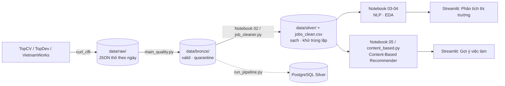

# IT Job Market Intelligence 🚀

Hệ thống thu thập, làm sạch, phân tích dữ liệu thị trường việc làm Công nghệ Thông tin (IT) tại Việt Nam và **gợi ý việc làm theo hồ sơ ứng viên** (Content-Based Filtering), theo kiến trúc **Data Engineering & Market Intelligence**.

---

## 📑 Tài Liệu Theo Từng Phân Hệ

| Phân hệ / Thư mục | Tài liệu chi tiết | Nhiệm vụ chính |
| :--- | :--- | :--- |
| **`src/crawlers/`** | [📖 Web Crawlers](src/crawlers/README.md) | Thu thập dữ liệu từ TopCV, TopDev, VietnamWorks; vượt Cloudflare WAF; quản lý hàng đợi pending. |
| **`src/profiling/`** | [📖 Data Profiling](src/profiling/README.md) | Kiểm kê kho dữ liệu, đo tỷ lệ thiếu, phân tích ngôn ngữ (`vi`/`en`/`mixed`), so sánh schema. |
| **`src/quality/`** | [📖 Data Quality](src/quality/README.md) | Rule engine phân luồng bản ghi `valid` / `invalid` / `quarantine`, sinh tầng Master Bronze. |
| **`sql/`** | [📖 Thiết kế Silver (PostgreSQL)](sql/README.md) | ERD 9 bảng, schema Silver / Gold. |
| **`notebook/`** | [📖 Notebook](notebook/README.md) | Quy trình làm sạch, NLP, EDA và xây dựng + đánh giá hệ gợi ý CBF. **Nơi nên đọc đầu tiên để hiểu logic.** |
| **`tests/`** | [📖 Test Suite](tests/README.md) | Pytest (56 test), cơ chế Sandbox Output cô lập không làm bẩn dữ liệu raw. |
| **`reports/`** | [📋 Báo cáo Profiling](reports/profiling/latest_summary.md) | Tình trạng dữ liệu thô và lịch sử chỉ số chất lượng. |

---

## 🏛️ Kiến Trúc Luồng Dữ Liệu (Medallion)



| Tầng | Nội dung | Trạng thái |
| :--- | :--- | :--- |
| **Raw** (`data/raw/`) | JSON gốc bất biến theo ngày, gồm `listings/` (sổ trạng thái pending/success/failed) và `details/`. | ✅ Hoạt động |
| **Bronze** (`data/bronze/`) | Bản ghi đã kiểm định chất lượng: `bronze_details_valid.json`, `bronze_details_quarantine.json`, `bronze_listings_master.json`. | ✅ Hoạt động |
| **Silver** (`data/silver/`, `data/notebook/content_base/jobs_clean.csv`) | Dữ liệu làm sạch, chuẩn hóa lương (VNĐ/tháng, loại giá trị phi lý)/kinh nghiệm/địa điểm, tách kỹ năng, khử trùng lặp. | ✅ Hoạt động |
| **Silver PostgreSQL** (`sql/`) | Nạp Bronze vào DB quan hệ 9 bảng (cần PostgreSQL, cấu hình qua `.env`). *Tùy chọn: hệ gợi ý và app không phụ thuộc DB.* | ✅ Có pipeline |
| **Gold** (`data/gold/`, `sql/schema_gold.sql`) | Bảng tổng hợp phục vụ phân tích. | 🟡 Mới có schema |

**Quy mô dữ liệu** (ảnh chụp ngày 05/11/2026): 5.491 tin Bronze hợp lệ ➔ **5.111 tin sạch** sau khử trùng lặp (loại 380) ➔ **3.470 tin thuộc ngành IT** được dùng cho hệ gợi ý. Nguồn: TopCV (~67%), VietnamWorks (~30%), TopDev và Saramin chiếm tỷ lệ nhỏ.

---

## 🎯 Hệ Gợi Ý Việc Làm (Content-Based Filtering)

Người dùng nhập **chức danh mong muốn, kỹ năng, đoạn CV, số năm kinh nghiệm, thành phố, hình thức làm việc, mức lương** ➔ hệ thống trả về Top-N việc làm kèm điểm thành phần, lời giải thích và phân tích **khoảng cách kỹ năng** (đã có / còn thiếu).

$$\text{Score} = 0{,}30\,S_{\text{skills}} + 0{,}40\,S_{\text{text}} + 0{,}10\,S_{\text{exp}} + 0{,}10\,S_{\text{loc}} + 0{,}10\,S_{\text{salary}}$$

- **$S_{\text{text}}$**: cosine TF-IDF giữa hồ sơ và "content soup" của job (*Title ×3 + Skills ×4 + Tags ×1 + Description*), **chuẩn hóa theo truy vấn** (job giống nhất = 1,0). Tokenizer giữ nguyên `C++`, `C#`, `.NET`, `CI/CD` và chữ tiếng Việt có dấu.
- **$S_{\text{skills}}$**: tỷ lệ khớp kỹ năng công nghệ, nhân **hệ số tin cậy** $\frac{m}{m+1}$ ($m$ = số kỹ năng khớp) để job chỉ yêu cầu 1 kỹ năng không tự động đạt 100%. **Kỹ năng gần nhau** (cùng nhóm thay thế được, vd. PostgreSQL ~ MySQL, Vue ~ React) được tính 0,5 kỹ năng khớp và hiển thị riêng trong phần Skill Gap.
- **Co giãn trọng số**: thành phần thiếu dữ liệu (lương thỏa thuận, job không liệt kê kỹ năng) bị loại và các trọng số còn lại được chuẩn hóa về tổng 1.
- **Dữ liệu đầu vào**: kỹ năng công nghệ (`required_skills`) được **tách khỏi thẻ ngành/chức danh** (`job_tags`) và rác (phúc lợi, học vấn); chỉ giữ tin thuộc ngành IT (`is_it`).

**Kết quả đánh giá** (25 hồ sơ mẫu, 5 nhóm nghề, top-5): Precision@5 ≈ **0,84**, NDCG@5 ≈ **0,85** (công thức đầu tiên chỉ đạt ~0,51 / 0,52). Khi **bỏ tiêu đề khỏi truy vấn** (để truy vấn và nhãn không chung nguồn), kết quả vẫn đạt 0,83 / 0,82, tức engine tìm đúng nhóm nghề nhờ nội dung kỹ năng chứ không nhờ trùng chữ tiêu đề. Bảng ablation đầy đủ ở mục 8 của [notebook 05](notebook/05_recommender/01_cbf_engine_and_evaluation.ipynb).

> ⚠️ **Hạn chế:** nhãn "liên quan" được suy ra từ *tiêu đề* và chỉ có 25 hồ sơ, nên đây là thước đo gần đúng (proxy); chênh lệch nhỏ (~0,03) có thể chỉ là nhiễu. Chưa có dữ liệu click/ứng tuyển thật hay tập nhãn tay.

---

## 🚀 Hướng Dẫn Nhanh (Quickstart)

### 1. Cài đặt môi trường

```powershell
python -m venv .venv
.\.venv\Scripts\Activate.ps1
pip install -r requirements.txt
```

### 2. Thu thập dữ liệu (`main_crawl.py`)

```powershell
python main_crawl.py --source all --target 100        # cả 3 nguồn, mỗi nguồn 100 tin thành công
python main_crawl.py --source topcv --target 50       # riêng một nguồn
python main_crawl.py --source all --retry-failed      # cào bù các tin lỗi trước đó
```

### 3. Kiểm định chất lượng ➔ Master Bronze (`main_quality.py`)

```powershell
python main_quality.py --save-bronze                  # kiểm định toàn bộ lịch sử và lưu 3 file Master Bronze
python main_quality.py --latest                       # chỉ ngày cào mới nhất
```

### 4. Profiling kho dữ liệu (`main_profile.py`)

```powershell
python main_profile.py                                # toàn bộ kho
python main_profile.py --latest                       # chỉ ngày mới nhất
```

### 5. Làm sạch dữ liệu (tạo `jobs_clean.csv`)

Có hai cách, cho **cùng một kết quả** (đã đối chiếu 100% trên `required_skills`, `job_tags`, `is_it`, `city`):

```powershell
# (a) Khuyên dùng khi muốn hiểu logic: chạy notebook 02 trong Jupyter
# Mở notebook/02_data_pipeline/02_data_cleaning_and_deduplication.ipynb trong VS Code,
# chọn kernel ".venv" (góc phải trên) rồi bấm "Run All"

# (b) Chạy tự động bằng module Python
python -m src.data_cleaning.job_cleaner
```

> Cả hai đều **ghi đè** `data/silver/jobs_cleaned.{csv,parquet}` và `data/notebook/content_base/jobs_clean.csv`.

### 6. Chạy ứng dụng Streamlit

```powershell
streamlit run app/Home.py
```

Lần đầu mở app, mô hình TF-IDF sẽ tự huấn luyện lại nếu dữ liệu hoặc phiên bản tokenizer thay đổi (vài giây), rồi lưu vào `data/models/`.

### 7. Pipeline tự động đến PostgreSQL (tùy chọn)

```powershell
copy .env.example .env      # điền thông tin PostgreSQL
python scripts/init_silver_db.py
python run_pipeline.py --source all --target 100        # cào ➔ kiểm định Bronze ➔ nạp Silver
python run_pipeline.py --skip-crawl                     # bỏ qua cào, chỉ kiểm định và nạp
```

### 8. Kiểm thử tự động

```powershell
pytest tests -v        # 56 test, chạy offline
```

---

## 📁 Cấu Trúc Dự Án

```text
IT-Job-Market-Intelligence/
├── app/                          # Ứng dụng Streamlit
│   ├── Home.py                   #   Trang gợi ý việc làm (CBF)
│   ├── pages/1_Phan_Tich_Thi_Truong.py   # Trang phân tích thị trường
│   └── components/               #   Biểu đồ, chỉ số, giao diện
├── configs/sources.yaml          # Endpoint, headers, rate-limit các sàn
├── data/                         # (Ignored by Git) raw ➔ bronze ➔ silver, models/, embeddings/
├── notebook/                     # 01 crawl · 02 làm sạch · 03 NLP · 04 EDA · 05 recommender (xem notebook/README.md)
├── reports/profiling/            # Báo cáo chất lượng dữ liệu
├── scripts/                      # Khởi tạo DB Silver, sửa lương TopCV, công cụ kiểm tra
├── sql/                          # Schema Silver / Gold + tài liệu ERD
├── src/
│   ├── crawlers/                 # TopCV, TopDev, VietnamWorks
│   ├── profiling/                # Kiểm kê và đo lường chất lượng
│   ├── quality/                  # Rule engine valid / invalid / quarantine
│   ├── data_cleaning/            # Làm sạch Bronze ➔ Silver
│   │   ├── job_cleaner.py        #   Pipeline làm sạch (tương đương notebook 02)
│   │   ├── skill_canonical.py    #   Từ điển kỹ năng, tách kỹ năng / thẻ ngành
│   │   ├── location.py           #   Chuẩn hóa thành phố (xử lý không dấu)
│   │   ├── dedup.py              #   Khử trùng lặp 3 lớp
│   │   └── it_filter.py          #   Gắn cờ tin thuộc ngành IT
│   ├── recommender/
│   │   ├── content_based.py      #   Engine CBF (tương đương notebook 05)
│   │   └── text_utils.py         #   Tokenizer giữ C++/C#/.NET và tiếng Việt có dấu
│   ├── pipelines/silver/         # Nạp PostgreSQL (extractor, transformers, loaders)
│   ├── embeddings/               # Sinh vector ngữ nghĩa (SentenceTransformer, thử nghiệm)
│   └── schemas/                  # Pydantic schema JobListingRaw / JobDetailRaw
├── tests/                        # Pytest (unit + integration)
├── _archive/                     # Mã cũ: FastAPI + web HTML, collaborative filtering (không còn dùng)
├── main_crawl.py · main_quality.py · main_profile.py · run_pipeline.py   # CLI
└── requirements.txt
```

> **Quy ước:** logic được viết và kiểm chứng trong notebook trước, sau đó đồng bộ sang `src/`. Khi sửa một bên, hãy cập nhật bên còn lại.

---

## 🗺️ Lộ Trình

- [x] **Phase 1 - Ingestion & Crawlers**: TopCV, TopDev, VietnamWorks với WAF bypass, pending queue, smart stop.
- [x] **Phase 2 - Profiling & Data Quality**: Báo cáo kiểm kê, nhận diện ngôn ngữ, rule engine `valid` / `invalid` / `quarantine`, Master Bronze.
- [x] **Phase 3 - Silver**: Chuẩn hóa lương / kinh nghiệm / địa điểm, tách kỹ năng và thẻ ngành, khử trùng lặp nhiều lớp, pipeline nạp PostgreSQL.
- [x] **Phase 4 - Recommender & App**: Content-Based Filtering (TF-IDF + chấm điểm đa thành phần), Streamlit gợi ý việc làm và phân tích thị trường.
- [x] **Kỹ năng gần nhau** (PostgreSQL ~ MySQL, Vue ~ React) tính 0,5 điểm; đánh giá không dùng tiêu đề (notebook 05, mục 8.4).
- [ ] **Cải thiện CBF**: tập nhãn tay / log tương tác thật để đánh giá đáng tin hơn; hybrid với embedding ngữ nghĩa (cần sinh lại vector cho khớp dữ liệu); tinh chỉnh thành phần vị trí/hình thức (98,7% tin là Onsite). ~21% job IT không liệt kê kỹ năng là vì mô tả thật sự không nhắc công nghệ nào (BA, kinh doanh phần mềm, quản lý sản phẩm...), không bóc thêm được.
- [ ] **Gold layer**: bảng tổng hợp xu hướng kỹ năng theo cấp bậc / thời gian.
