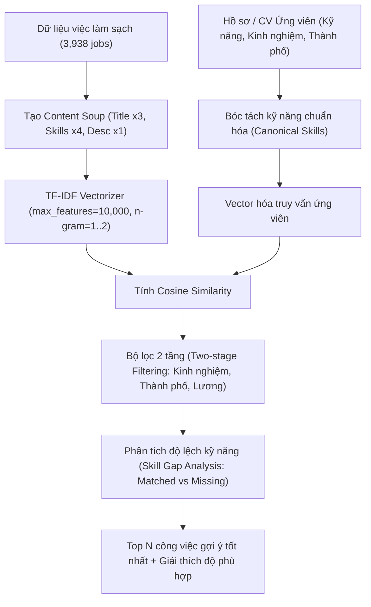

# Jupyter Notebooks — IT Job Market Intelligence 🚀

Thư mục chứa toàn bộ Jupyter Notebooks phục vụ nghiên cứu, phân tích dữ liệu thị trường IT và phát triển **Hệ thống Gợi ý Việc làm Dựa trên Nội dung (Content-Based Recommendation System)**.

---

## 📁 Cấu trúc luồng thực nghiệm chuẩn (Pipeline Flow)

Các notebook được tổ chức thành **5 bước tuần tự** theo chu trình chuẩn của một bài toán Khoa học Dữ liệu & Hệ thống Gợi ý:

```text
notebook/
│
├── 01_crawling/                            # [Bước 1] Thu thập dữ liệu việc làm thực tế
│   ├── crawl_data.ipynb                    → Crawl tổng hợp đa nguồn (TopCV, TopDev, VietnamWorks)
│   ├── crawl_topdev.ipynb                  → Thử nghiệm crawler riêng TopDev (HTML Parser)
│   └── crawl_vietnamworks.ipynb            → Thử nghiệm crawler riêng VietnamWorks (REST API)
│
├── 02_data_pipeline/                       # [Bước 2] Tiền xử lý, làm sạch & chuẩn hóa dữ liệu
│   ├── 01_clean_jobs_for_cbf.ipynb         → 13 bước làm sạch chuyên sâu dữ liệu Bronze cho Content-Based
│   ├── experiment_silver_cleaning.ipynb    → Thử nghiệm chuẩn hóa & khử trùng lặp (Deduplication)
│   └── view_history_metrics.ipynb          → Theo dõi lịch sử và chỉ số chất lượng pipeline
│
├── 03_nlp_embeddings/                      # [Bước 3] Xử lý ngôn ngữ tự nhiên (NLP) & Trích xuất đặc trưng
│   ├── nlp_pipeline_deepdive.ipynb         → Chuẩn hóa chức danh, Regex-NER bóc tách kỹ năng, ma trận đồng xuất hiện
│   └── semantic_embedding_experiment.ipynb → Thử nghiệm SentenceTransformer (384d) biểu diễn ngữ nghĩa bài đăng
│
├── 04_eda/                                 # [Bước 4] Phân tích khám phá dữ liệu thị trường (EDA)
│   └── 01_eda_job_market_insights.ipynb    → Phân tích phân bố lương, số năm kinh nghiệm, địa lý và top công nghệ hot
│
├── 05_recommender/                         # [Bước 5] Hệ thống gợi ý việc làm trọng tâm
│   └── content_based_filtering.ipynb       → Mô hình Content-Based (Content Soup + TF-IDF + Cosine Sim + Evaluation)
│
└── _archive/                               # [Lưu trữ] Các thực nghiệm kiểm tra DB hoặc giai đoạn sau
    ├── silver_tables/                      → 9 notebook kiểm tra chi tiết các bảng SQL Database
    ├── collaborative_filtering_experiment.ipynb
    └── true_hybrid_recommender_experiment.ipynb
```

---

## 💡 Luồng hoạt động của Hệ Thống Gợi Ý (Content-Based Recommender)



---

## 🚀 Hướng dẫn chạy thử nghiệm

1. **Kích hoạt môi trường ảo**:
   ```powershell
   .\.venv\Scripts\Activate.ps1
   ```
2. **Khởi chạy Jupyter Lab**:
   ```powershell
   jupyter lab
   ```
3. **Thứ tự thực hiện khuyến nghị**:
   - Chạy `02_data_pipeline/01_clean_jobs_for_cbf.ipynb` nếu muốn sinh lại file `data/notebook/content_base/jobs_clean.csv`.
   - Chạy `04_eda/01_eda_job_market_insights.ipynb` để trực quan hóa biểu đồ thị trường.
   - Chạy `05_recommender/content_based_filtering.ipynb` để kiểm chứng thuật toán gợi ý và đo lường độ chính xác (Precision, Recall, Diversity).
4. **Trực quan hóa trên giao diện Streamlit**:
   ```powershell
   streamlit run app/Home.py
   ```
