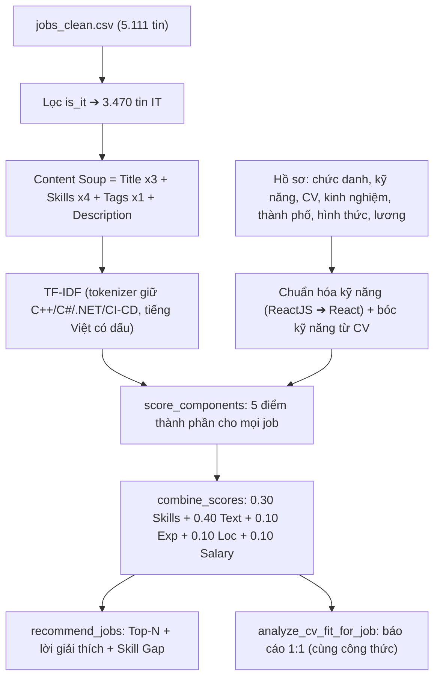

# Jupyter Notebooks - IT Job Market Intelligence 🚀

Thư mục chứa các notebook phục vụ nghiên cứu dữ liệu thị trường IT và phát triển **Hệ thống Gợi ý Việc làm Dựa trên Nội dung (Content-Based Filtering - CBF)**.

> **Nguyên tắc làm việc:** logic được viết và kiểm chứng **trong notebook trước** (mọi hàm nằm ngay trong cell, không `import` từ `src/`), sau đó mới đồng bộ sang `src/`. Bản `.py` tương ứng: notebook 02 ↔ `src/data_cleaning/job_cleaner.py`, notebook 05 ↔ `src/recommender/content_based.py`. Hai phía đã được đối chiếu cho **kết quả giống hệt nhau**.

---

## 📁 Cấu trúc & thứ tự chạy

```text
notebook/
│
├── 01_crawling/                                 # [Bước 0] Thu thập dữ liệu thô
│   ├── crawl_data.ipynb                         → Thu thập đa nguồn (TopCV, TopDev, VietnamWorks)
│   ├── crawl_topdev.ipynb                       → Thử nghiệm crawler TopDev (HTML Parser)
│   └── crawl_vietnamworks.ipynb                 → Thử nghiệm crawler VietnamWorks (REST API)
│
├── 02_data_pipeline/                            # [Bước 1-3] Chất lượng & làm sạch dữ liệu
│   ├── 01_data_quality_inspection.ipynb         → Kiểm tra schema, null, trùng lặp
│   ├── 02_data_cleaning_and_deduplication.ipynb → 13 bước làm sạch ➔ sinh jobs_clean.csv  ★
│   └── 03_view_history_quality_metrics.ipynb    → Theo dõi biến động chỉ số chất lượng
│
├── 03_nlp_embeddings/                           # [Chuyên đề NLP]
│   ├── 01_nlp_skill_extraction.ipynb            → Chuẩn hóa chức danh, bóc tách kỹ năng, ma trận đồng xuất hiện
│   └── 02_semantic_embedding_experiment.ipynb   → Thử nghiệm SentenceTransformer (384 chiều)
│
├── 04_eda/
│   └── 01_eda_job_market_insights.ipynb         → Phân bố lương, kinh nghiệm, địa lý, top tech stacks
│
├── 05_recommender/
│   └── 01_cbf_engine_and_evaluation.ipynb       → Engine CBF + đánh giá + bảng ablation  ★
│
└── _archive/                                    # Thử nghiệm cũ (collaborative filtering, hybrid, bảng Silver)
```

**Thứ tự khuyến nghị:** `02/01` ➔ `02/02` (sinh `jobs_clean.csv`) ➔ `04` ➔ `05`.

---

## 🧹 Notebook 02 - Làm sạch: những điểm đáng chú ý

Đầu vào: `data/bronze/bronze_details_valid.json` (5.491 bản ghi). Đầu ra: `jobs_clean.csv` (5.111 bản ghi × 20 cột, ảnh chụp 05/11/2026).

| Bước | Nội dung | Điểm cần nhớ |
| :--- | :--- | :--- |
| 4 | Kỹ năng | `required_skills_raw` của sàn **trộn lẫn** kỹ năng, thẻ ngành và rác. Tách thành `required_skills` (chỉ kỹ năng công nghệ), `job_tags` (ngành/chức danh/ngoại ngữ) và loại bỏ rác (phúc lợi, học vấn). Không tách thì thẻ `It - Phần Mềm` (~31% tin) trở thành "kỹ năng" phổ biến nhất. |
| 7 | Thành phố | Bỏ dấu trước khi so khớp (nhận cả `hanoi`, `ha noi`), dùng ranh giới từ, địa chỉ nhiều thành phố lấy thành phố xuất hiện đầu tiên. |
| 12 | Khử trùng lặp | 3 lớp: trùng chính xác, biến thể tên công ty (`MBBANK` ↔ `NGÂN HÀNG TMCP QUÂN ĐỘI – MBBANK`), đăng lại. Lớp 3 **bắt buộc** kèm điều kiện tiêu đề, thành phố, kinh nghiệm vì nhiều tin cùng công ty chia sẻ phần giới thiệu/phúc lợi giống hệt nhau. Loại 380 bản ghi. |
| 12b | Cờ `is_it` | Dữ liệu có cả việc thiết kế đồ họa, kinh doanh, kế toán. Gắn cờ thay vì xóa để mỗi bước sau tự chọn. 3.470/5.111 tin là IT. |
| 13 | Xuất file | `data/notebook/content_base/jobs_clean.csv` (cho notebook), `data/silver/jobs_cleaned.{csv,parquet}` (cho Streamlit). **Ghi đè** file cũ. |

---

## 🎯 Notebook 05 - Engine CBF



### Các mục trong notebook
1. Nạp dữ liệu, lọc ngành IT. 2. Khảo sát chất lượng. 3. Chuẩn hóa kỹ năng, dựng content soup. 4. TF-IDF và tokenizer (có bảng so sánh tokenizer cũ/mới). 5. Bộ chấm điểm. 6. Case studies. 7. Chẩn đoán phân bố điểm. 8. Đánh giá và ba bảng ablation.

### Ba lỗi đã tìm ra và sửa (chi tiết ở mục 4 và 5 của notebook)
| Lỗi | Hậu quả | Cách sửa |
| :--- | :--- | :--- |
| `token_pattern` cũ không giữ được `C++`/`C#` (cùng thành `c`) và **xóa sạch chữ tiếng Việt có dấu** | Vector văn bản mất thông tin | Tiền xử lý `C++`➔`cpp`, `C#`➔`csharp`...; dùng `\w\w+` |
| Điểm kỹ năng = tỷ lệ kỹ năng job yêu cầu mà bạn có ➔ job chỉ yêu cầu 1 kỹ năng đạt ngay 100% | Job lệch nghề vẫn thắng job đúng nghề (Precision@5 chỉ 0,48) | Nhân hệ số tin cậy $m/(m+1)$; loại thành phần khi job không có kỹ năng |
| Cosine thô hiếm khi vượt 0,5 nên trọng số văn bản bị các thành phần thang 0-1 lấn át | Văn bản gần như không ảnh hưởng thứ hạng | Chuẩn hóa theo truy vấn (job giống nhất = 1,0) |

### Kết quả đánh giá (25 hồ sơ mẫu, 5 nhóm nghề, top-5)

| Công thức | P@5 | NDCG@5 |
| :--- | :--- | :--- |
| Ban đầu (trọng số kỹ năng : văn bản = 0,40 : 0,30) | 0,49 | 0,49 |
| Sau khi sửa cách chấm điểm (vẫn 0,40 : 0,30) | 0,78 | 0,80 |
| + đổi trọng số sang 0,30 : 0,40 (**đang dùng**) | **0,82** | **0,83** |
| Tham chiếu: chỉ dùng văn bản | 0,87 | 0,84 |

*Bảng ablation 8.2 trong notebook chạy hoàn toàn ở trọng số đang dùng (0,30 : 0,40), nên dòng "công thức cũ" ở đó là 0,59 / 0,60 chứ không phải 0,49: cùng một công thức cũ nhưng đo ở trọng số mới.*

> ⚠️ **Đọc kết quả cho đúng:** nhãn "liên quan" suy ra từ **tiêu đề** và chỉ có 25 hồ sơ, nên đây là thước đo gần đúng; chênh lệch ~0,03 có thể chỉ là nhiễu. Chỉ **tokenizer mới** và **công thức chấm điểm** cho cải thiện nhất quán. Việc tách kỹ năng/thẻ và lọc IT được giữ vì lý do thiết kế, chưa chứng minh được bằng số liệu. Mục 8.3 quét trọng số cũng chịu thiên lệch này (truy vấn chứa tiêu đề, trùng nguồn với nhãn), nên không nên hiểu "`w_skills = 0` tốt nhất" là nên bỏ điểm kỹ năng.

---

## 🚀 Hướng dẫn chạy

1. **Kích hoạt môi trường ảo**
   ```powershell
   .\.venv\Scripts\Activate.ps1
   ```
2. **Mở Jupyter**
   ```powershell
   jupyter lab
   ```
3. **Chạy theo thứ tự**: `02_data_pipeline/02_data_cleaning_and_deduplication.ipynb` ➔ `04_eda/...` ➔ `05_recommender/...`.
   - Notebook 05 **yêu cầu** các cột `job_tags` và `is_it` do notebook 02 mới sinh ra; thiếu sẽ báo lỗi rõ ràng ngay ở cell đầu.
   - Mục 8.1-8.3 của notebook 05 chạy khoảng 2 phút (gọi nhiều lần hàm gợi ý).
   - Output đã bị xóa ở các cell được sửa gần đây; chạy lại để thấy kết quả.
4. **Chạy ứng dụng Streamlit**
   ```powershell
   streamlit run app/Home.py
   ```

> **Lưu ý:** notebook 03 (`01_nlp_skill_extraction`) đang báo lỗi `too many values to unpack` ở cell 21 khi chạy lại; lỗi này không liên quan đến `jobs_clean.csv` và chưa được xử lý.
