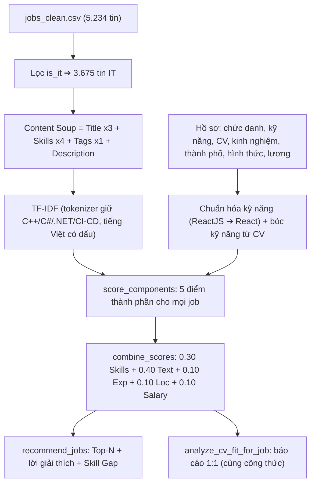

# Jupyter Notebooks - IT Job Market Intelligence 🚀

Thư mục chứa các notebook phục vụ nghiên cứu dữ liệu thị trường IT và phát triển **Hệ thống Gợi ý Việc làm Dựa trên Nội dung (Content-Based Filtering - CBF)**.

> **Nguyên tắc làm việc:** logic được viết và kiểm chứng **trong notebook trước** (mọi hàm nằm ngay trong cell, không `import` từ `src/`), sau đó mới đồng bộ sang `src/`. Bản `.py` tương ứng: notebook 02 ↔ `src/data_cleaning/job_cleaner.py`, notebook 05 ↔ `src/recommender/content_based.py`. Hai phía đã được đối chiếu cho **kết quả giống hệt nhau**.

---

## 📁 Cấu trúc & thứ tự chạy

```text
notebook/
│
├── 01_crawling/                                 # [Bước 0] Thu thập dữ liệu thô
│   ├── crawl_data.ipynb                         → Thu thập đa nguồn (TopCV, TopDev, VietnamWorks)
│   ├── crawl_topdev.ipynb                       → Thử nghiệm crawler TopDev (HTML Parser)
│   └── crawl_vietnamworks.ipynb                 → Thử nghiệm crawler VietnamWorks (REST API)
│
├── 02_data_pipeline/                            # [Bước 1-3] Chất lượng & làm sạch dữ liệu
│   ├── 01_data_quality_inspection.ipynb         → Kiểm tra schema, null, trùng lặp
│   ├── 02_data_cleaning_and_deduplication.ipynb → 13 bước làm sạch ➔ sinh jobs_clean.csv  ★
│   └── 03_view_history_quality_metrics.ipynb    → Theo dõi biến động chỉ số chất lượng
│
├── 03_nlp_embeddings/                           # [Chuyên đề NLP]
│   ├── 01_nlp_skill_extraction.ipynb            → Chuẩn hóa chức danh, bóc tách kỹ năng, ma trận đồng xuất hiện
│   └── 02_semantic_embedding_experiment.ipynb   → Thử nghiệm SentenceTransformer (384 chiều)
│
├── 04_eda/
│   └── 01_eda_job_market_insights.ipynb         → Phân bố lương, kinh nghiệm, địa lý, top tech stacks
│
├── 05_recommender/
│   └── 01_cbf_engine_and_evaluation.ipynb       → Engine CBF + đánh giá + bảng ablation  ★
│
├── 06_recommender_cf/
│   ├── 01_simulation.ipynb                      → Sinh dữ liệu tương tác mô phỏng ➔ data/simulated/
│   ├── 02_simulated_data_inspection.ipynb       → Xem dữ liệu mô phỏng TRƯỚC khi làm CF
│   └── 03_matrix_factorization.ipynb            → Matrix Factorization (ALS) + so sánh mô hình
│
├── 07_hybrid/
│   └── 01_hybrid_cbf_cf_for_app.ipynb           → Thiết kế & kiểm chứng Hybrid CBF + CF dùng trong Streamlit  ★
│
└── _archive/                                    # Thử nghiệm cũ (collaborative filtering, hybrid, bảng Silver)
```

**Thứ tự khuyến nghị:** `02/01` ➔ `02/02` (sinh `jobs_clean.csv`) ➔ `04` ➔ `05` ➔ `06` ➔ `07`.

---

## 🧹 Notebook 02 - Làm sạch: những điểm đáng chú ý

Đầu vào: `data/bronze/bronze_details_valid.json` (5.631 bản ghi). Đầu ra: `jobs_clean.csv` (5.234 bản ghi × 19 cột). Từ điển kỹ năng và từ khóa nghề IT nằm trong `configs/dictionaries/` (dùng chung với ứng dụng).

| Bước | Nội dung | Điểm cần nhớ |
| :--- | :--- | :--- |
| 3 | Mô tả | Gỡ thẻ HTML, thực thể HTML, ký hiệu đầu dòng, khoảng trắng và dòng trống thừa; có bảng số tin còn lỗi trước / sau và ví dụ hai cột. |
| 4 | Kỹ năng | `required_skills_raw` của sàn **trộn lẫn** kỹ năng, thẻ ngành và rác. Tách thành `required_skills` (chỉ kỹ năng công nghệ, theo `skills.yaml`), `job_tags` (ngành/chức danh/ngoại ngữ) và loại bỏ rác (phúc lợi, học vấn); bổ sung kỹ năng quét trong mô tả. |
| 6 | Thành phố | Bỏ dấu trước khi so khớp (nhận cả `hanoi`, `ha noi`), dùng ranh giới từ, địa chỉ nhiều thành phố lấy thành phố xuất hiện đầu tiên. |
| 7 | Lương | Quy đổi về **VNĐ/tháng**: đơn vị "triệu" chỉ nhận khi đi liền sau con số (`15tr`, `15-20M`; chữ `M` trong `MONTH` không tính), lương **năm** chia 12, số không ghi đơn vị 100-20.000 là USD, giá trị ngoài [1 triệu, 300 triệu]/tháng bị loại. Khoảng lương ghi trong tiêu đề chỉ dùng khi chuỗi gốc không có số. |
| 11 | Khử trùng lặp | 3 lớp: trùng chính xác, biến thể tên công ty (`MBBANK` ↔ `NGÂN HÀNG TMCP QUÂN ĐỘI – MBBANK`), đăng lại. Lớp 3 **bắt buộc** kèm điều kiện tiêu đề, thành phố, kinh nghiệm vì nhiều tin cùng công ty chia sẻ phần giới thiệu/phúc lợi giống hệt nhau. Loại 397 bản ghi. |
| 11b | Cờ `is_it` | Tiêu đề khớp từ khóa nghề IT (gồm cả game / đồ họa số: Game Designer, Animator, 3D Artist...) hoặc có ≥ 2 kỹ năng lõi. Gắn cờ thay vì xóa để mỗi bước sau tự chọn. 3.675/5.234 tin là IT. |
| 12 | Xuất file | `data/notebook/content_base/jobs_clean.csv` (cho notebook), `data/silver/jobs_cleaned.{csv,parquet}` (cho Streamlit). **Ghi đè** file cũ. |

---

## 🎯 Notebook 05 - Engine CBF



### Các mục trong notebook
**Phần chính:** 1. Nạp dữ liệu, lọc ngành IT. 2. Chuẩn hóa kỹ năng, dựng content soup. 3. TF-IDF (tokenizer giữ `C++`, `C#`, `.NET`, `CI/CD` và chữ tiếng Việt có dấu). 4. Bộ chấm điểm (4.1 điểm thành phần, 4.2 lời giải thích, 4.3 ba bước chấm điểm, 4.4 báo cáo 1:1). 5. Case studies. 6. Đánh giá (6.1 không dùng tiêu đề, 6.2 bảng kết quả chính).
**Phụ lục:** A. Khảo sát dữ liệu. B. Phân bố điểm. C. Quét trọng số kỹ năng : văn bản.

### Cách tính điểm (chi tiết ở mục 4 của notebook)
| Thành phần | Cách tính |
| :--- | :--- |
| Văn bản (40%) | Cosine TF-IDF giữa hồ sơ và content soup, **chia cho cosine lớn nhất** của truy vấn (tin giống nhất = 1,0) |
| Kỹ năng (30%) | Độ phủ × hệ số tin cậy $m/(m+1)$, với $m$ = số kỹ năng khớp + 0,5 × số kỹ năng **gần nhau** (cùng nhóm thay thế được trong `skill_groups.yaml`: PostgreSQL ~ MySQL, Vue ~ React) |
| Kinh nghiệm, vị trí / hình thức, lương (10% mỗi phần) | So trực tiếp với cột của tin |
| Thiếu dữ liệu | Thành phần bị bỏ, trọng số còn lại co giãn về tổng 1 |

### Kết quả đánh giá (25 hồ sơ mẫu, 5 nhóm nghề, top-5)

| Cấu hình | P@5 | NDCG@5 |
| :--- | :--- | :--- |
| Toàn pipeline (truy vấn có tiêu đề) | **0,82** | **0,83** |
| Toàn pipeline, **bỏ tiêu đề** khỏi truy vấn (mục 6.1) | 0,78 | 0,80 |
| Bỏ tiêu đề, chỉ điểm văn bản | 0,80 | 0,82 |
| Bỏ tiêu đề, chỉ điểm kỹ năng | 0,62 | 0,62 |

Nhãn "liên quan" lấy từ tiêu đề tin, nên mục 6.1 bỏ tiêu đề khỏi truy vấn để truy vấn và nhãn không còn chung nguồn. Điểm chỉ giảm nhẹ, nên engine tìm đúng nhóm nghề nhờ nội dung kỹ năng chứ không nhờ trùng chữ tiêu đề. Mức 0,5 cho kỹ năng gần nhau được chọn bằng cách quét 0-1 ở chế độ không tiêu đề (mục 6.1). Bảng **6.2** trong notebook tự tính lại các số này mỗi lần chạy.

> ⚠️ **Đọc kết quả cho đúng:** nhãn "liên quan" suy ra từ **tiêu đề** và chỉ có 25 hồ sơ, nên đây là thước đo gần đúng; chênh lệch ~0,03 có thể chỉ là nhiễu. Phụ lục C quét trọng số cũng chịu thiên lệch truy vấn chứa tiêu đề, nên không nên hiểu "`w_skills = 0` tốt nhất" là nên bỏ điểm kỹ năng.
>
> ~21% tin IT không có kỹ năng **không phải do thiếu bước bóc tách**: notebook 02 đã quét cả mô tả; các tin này là BA, kinh doanh phần mềm, quản lý sản phẩm... mà mô tả không nhắc công nghệ nào.

---

## 🤝 Notebook 06 - Lọc cộng tác trên dữ liệu mô phỏng

Dự án chưa có log tương tác thật, nên notebook 06 **sinh dữ liệu mô phỏng** từ các tin IT thật (`01_simulation`), **xem kỹ dữ liệu đó** (`02_simulated_data_inspection`), rồi mới so sánh CF với CBF (`03_matrix_factorization`). Sở thích thật của người dùng mô phỏng gồm cả phần **nội dung** (CBF thấy được) lẫn phần **ẩn** (loại công ty, thương hiệu), để phép so sánh CF với CBF công bằng.

| Thành phần | Thiết kế |
| :--- | :--- |
| Người dùng (3.000) | kỹ năng lấy mẫu từ kỹ năng thật của tin cùng nhóm nghề; kinh nghiệm, thành phố theo phân bố của kho |
| Sở thích thật | $U = \alpha \cdot z(\text{nội dung}) + (1-\alpha) \cdot z(\text{ẩn})$. Phần ẩn (loại công ty theo 6 cụm khẩu vị, thương hiệu, độ hấp dẫn của tin) CBF không thấy được |
| Hành vi | mỗi phiên thấy 20 tin đang mở (tìm kiếm / gợi ý / khám phá), thiên lệch vị trí, phễu bấm ➔ lưu ➔ ứng tuyển; tỷ lệ bấm ~6%, độ thưa 99,8% |
| Đánh giá | chia theo thời gian (10 ngày cuối làm test), chọn tham số trên validation riêng; NDCG@10 theo log và **Oracle-P@10** theo sở thích thật |

**Kết quả chính ($\alpha = 0{,}5$, test):**

| Mô hình | NDCG@10 (log) | Oracle-P@10 | Recall@10 tin mới |
| :--- | :--- | :--- | :--- |
| ItemKNN | 0,029 | 0,084 | 0 |
| SVD (coi ô trống là "không thích") | 0,033 | 0,136 | 0 |
| ALS (MF cho phản hồi ngầm) | 0,040 | 0,159 | 0 |
| CBF (rút gọn) | 0,050 | 0,099 | 0,099 |
| **Hybrid CBF + ALS** | **0,061** | **0,181** | 0,094 |

- ALS là mô hình CF tốt nhất nhưng **không gợi ý được tin mới** (~43% tin ứng viên ở giai đoạn test chưa có tương tác). Hybrid giữ được điểm mạnh của cả hai.
- **Log hành vi thiên vị CBF:** theo sở thích thật, ALS hơn CBF khi $\alpha \le 0{,}5$; nhưng theo log, CBF đã hơn từ $\alpha = 0{,}35$, vì người dùng chủ yếu được hiển thị tin do hệ thống dựa trên nội dung chọn.
- Đây là dữ liệu mô phỏng: chỉ nên đọc **xu hướng và thứ tự** giữa các mô hình, không đọc giá trị tuyệt đối. Bộ dữ liệu được lưu ở `data/simulated/` (sinh lại y hệt nhờ cố định `SEED`).

---

## 🔗 Notebook 07 - Hybrid CBF + CF cho ứng dụng

Dùng lại bộ dữ liệu mô phỏng của notebook 06 (`data/simulated/`) để quyết định cách đưa Hybrid vào Streamlit. Bản `.py` tương ứng: `src/recommender/collaborative.py` (ALS, nhật ký tương tác) và `src/recommender/hybrid.py`.

| Câu hỏi | Kết luận (xem ô kiểm tra tự động ở mục 6) |
| :--- | :--- |
| Chọn công thức theo thước đo nào? | Theo **sở thích thật** (Oracle-P@10). Chọn theo NDCG của log sẽ ra công thức khác, vì log thiên vị hệ đang hiển thị tin |
| Công thức | $0{,}5 \cdot z(	ext{CBF}) + 0{,}5 \cdot z(	ext{CF})$; tin mới (CF chưa biết) chỉ dùng CBF. Oracle-P@10 0,095 (CBF) ➔ 0,151 (Hybrid, người dùng mới) mà vẫn giữ được tin mới |
| Trộn tuyến tính 0-100%? | Kém hơn: phải đánh đổi giữa độ chính xác và tin mới; CF chuẩn hóa min-max còn kém hơn nữa (điểm ALS lệch mạnh) |
| Bật CF từ bao nhiêu lượt tương tác? | Từ 1 lượt (Hybrid đã hơn CBF ngay ở nhóm 1-2 tương tác) |
| Người dùng mới | Fold-in (không huấn luyện lại) đạt ~84% so với huấn luyện lại đầy đủ; ở quy mô hiện tại ứng dụng huấn luyện lại ALS khi log đổi (~1 giây) |

**Kịch bản demo Streamlit:** nhập hồ sơ ➔ Tìm kiếm (chế độ CBF) ➔ bấm **Quan tâm** / **Ứng tuyển** ở vài tin ➔ Tìm kiếm lại ➔ chế độ chuyển sang **Hybrid**, tin đã quan tâm không bị gợi ý lại, mỗi thẻ có thêm điểm CF.

---

## 🚀 Hướng dẫn chạy

1. **Kích hoạt môi trường ảo**
   ```powershell
   .\.venv\Scripts\Activate.ps1
   ```
2. **Mở notebook trong VS Code**: mở file `.ipynb`, chọn kernel `.venv` (góc phải trên), bấm **Run All**.
   (Môi trường hiện có `ipykernel` nhưng chưa cài JupyterLab; muốn dùng `jupyter lab` hãy `pip install jupyterlab`.)
3. **Chạy theo thứ tự**: `02_data_pipeline/02_data_cleaning_and_deduplication.ipynb` ➔ `04_eda/...` ➔ `05_recommender/...`.
   - Notebook 05 **yêu cầu** các cột `job_tags` và `is_it` do notebook 02 mới sinh ra; thiếu sẽ báo lỗi rõ ràng ngay ở cell đầu.
   - Mục 8.1-8.4 của notebook 05 chạy khoảng 3 phút (gọi nhiều lần hàm gợi ý).
   - Notebook 06 chạy khoảng 1 phút và ghi dữ liệu mô phỏng ra `data/simulated/` (khoảng 37 MB).
4. **Khi crawl thêm dữ liệu**: chạy `python scripts/refresh_pipeline.py` để làm mới Bronze rồi chạy lại 02/01 ➔ 02 ➔ 04 ➔ 05 ➔ 06 ➔ 07 và lưu output (khoảng 5 phút). Script dừng ở notebook lỗi đầu tiên và không ghi đè notebook đó. Số liệu trong các ô markdown là của ảnh chụp 05/11/2026; số liệu mới xem ở output.
5. **Chạy ứng dụng Streamlit**
   ```powershell
   streamlit run app/Home.py
   ```

> **Lưu ý:** notebook 03/02 (`02_semantic_embedding_experiment`) dùng bộ vector embedding sinh từ dữ liệu cũ (3.249 tin) và chưa được chạy lại; đây là thử nghiệm riêng, không ảnh hưởng hệ gợi ý.
