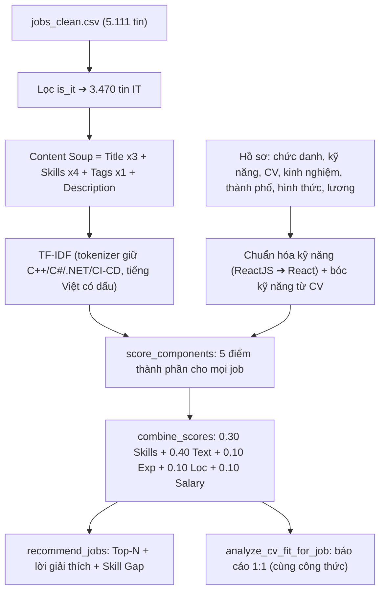

# Jupyter Notebooks - IT Job Market Intelligence 🚀

Thư mục chứa các notebook phục vụ nghiên cứu dữ liệu thị trường IT và phát triển **Hệ thống Gợi ý Việc làm Dựa trên Nội dung (Content-Based Filtering - CBF)**.

> **Nguyên tắc làm việc:** logic được viết và kiểm chứng **trong notebook trước** (mọi hàm nằm ngay trong cell, không `import` từ `src/`), sau đó mới đồng bộ sang `src/`. Bản `.py` tương ứng: notebook 02 ↔ `src/data_cleaning/job_cleaner.py`, notebook 05 ↔ `src/recommender/content_based.py`. Hai phía đã được đối chiếu cho **kết quả giống hệt nhau**.

---

## 📁 Cấu trúc & thứ tự chạy

```text
notebook/
│
├── 01_crawling/                                 # [Bước 0] Thu thập dữ liệu thô
│   ├── crawl_data.ipynb                         → Thu thập đa nguồn (TopCV, TopDev, VietnamWorks)
│   ├── crawl_topdev.ipynb                       → Thử nghiệm crawler TopDev (HTML Parser)
│   └── crawl_vietnamworks.ipynb                 → Thử nghiệm crawler VietnamWorks (REST API)
│
├── 02_data_pipeline/                            # [Bước 1-3] Chất lượng & làm sạch dữ liệu
│   ├── 01_data_quality_inspection.ipynb         → Kiểm tra schema, null, trùng lặp
│   ├── 02_data_cleaning_and_deduplication.ipynb → 13 bước làm sạch ➔ sinh jobs_clean.csv  ★
│   └── 03_view_history_quality_metrics.ipynb    → Theo dõi biến động chỉ số chất lượng
│
├── 03_nlp_embeddings/                           # [Chuyên đề NLP]
│   ├── 01_nlp_skill_extraction.ipynb            → Chuẩn hóa chức danh, bóc tách kỹ năng, ma trận đồng xuất hiện
│   └── 02_semantic_embedding_experiment.ipynb   → Thử nghiệm SentenceTransformer (384 chiều)
│
├── 04_eda/
│   └── 01_eda_job_market_insights.ipynb         → Phân bố lương, kinh nghiệm, địa lý, top tech stacks
│
├── 05_recommender/
│   └── 01_cbf_engine_and_evaluation.ipynb       → Engine CBF + đánh giá + bảng ablation  ★
│
├── 06_recommender_cf/
│   └── 01_simulation_and_matrix_factorization.ipynb → Dữ liệu tương tác mô phỏng + Matrix Factorization (ALS) + Hybrid
│
└── _archive/                                    # Thử nghiệm cũ (collaborative filtering, hybrid, bảng Silver)
```

**Thứ tự khuyến nghị:** `02/01` ➔ `02/02` (sinh `jobs_clean.csv`) ➔ `04` ➔ `05` ➔ `06`.

---

## 🧹 Notebook 02 - Làm sạch: những điểm đáng chú ý

Đầu vào: `data/bronze/bronze_details_valid.json` (5.491 bản ghi). Đầu ra: `jobs_clean.csv` (5.111 bản ghi × 20 cột, ảnh chụp 05/11/2026).

| Bước | Nội dung | Điểm cần nhớ |
| :--- | :--- | :--- |
| 4 | Kỹ năng | `required_skills_raw` của sàn **trộn lẫn** kỹ năng, thẻ ngành và rác. Tách thành `required_skills` (chỉ kỹ năng công nghệ), `job_tags` (ngành/chức danh/ngoại ngữ) và loại bỏ rác (phúc lợi, học vấn). Không tách thì thẻ `It - Phần Mềm` (~31% tin) trở thành "kỹ năng" phổ biến nhất. |
| 7 | Thành phố | Bỏ dấu trước khi so khớp (nhận cả `hanoi`, `ha noi`), dùng ranh giới từ, địa chỉ nhiều thành phố lấy thành phố xuất hiện đầu tiên. |
| 8 | Lương | Quy đổi về **VNĐ/tháng**. Sửa các lỗi từng làm lương sai: chữ `M` trong `MONTH` (TopDev) bị hiểu là "triệu" ➔ 10¹³ VNĐ; lương **năm** (`/năm`, VietnamWorks) chưa chia 12; số trần của TopCV (`500 - 2000`) thực chất là USD; giá trị ngoài [1 triệu, 300 triệu]/tháng bị loại. Khoảng lương ghi trong tiêu đề chỉ dùng khi chuỗi gốc không có số. |
| 12 | Khử trùng lặp | 3 lớp: trùng chính xác, biến thể tên công ty (`MBBANK` ↔ `NGÂN HÀNG TMCP QUÂN ĐỘI – MBBANK`), đăng lại. Lớp 3 **bắt buộc** kèm điều kiện tiêu đề, thành phố, kinh nghiệm vì nhiều tin cùng công ty chia sẻ phần giới thiệu/phúc lợi giống hệt nhau. Loại 380 bản ghi. |
| 12b | Cờ `is_it` | Dữ liệu có cả việc thiết kế đồ họa, kinh doanh, kế toán. Gắn cờ thay vì xóa để mỗi bước sau tự chọn. 3.470/5.111 tin là IT. |
| 13 | Xuất file | `data/notebook/content_base/jobs_clean.csv` (cho notebook), `data/silver/jobs_cleaned.{csv,parquet}` (cho Streamlit). **Ghi đè** file cũ. |

---

## 🎯 Notebook 05 - Engine CBF



### Các mục trong notebook
1. Nạp dữ liệu, lọc ngành IT. 2. Khảo sát chất lượng. 3. Chuẩn hóa kỹ năng, dựng content soup. 4. TF-IDF và tokenizer (có bảng so sánh tokenizer cũ/mới). 5. Bộ chấm điểm. 6. Case studies. 7. Chẩn đoán phân bố điểm. 8. Đánh giá: ba bảng ablation (8.1-8.3) và đánh giá không dùng tiêu đề (8.4).

### Các lỗi đã tìm ra và sửa (chi tiết ở mục 4 và 5 của notebook)
| Lỗi | Hậu quả | Cách sửa |
| :--- | :--- | :--- |
| `token_pattern` cũ không giữ được `C++`/`C#` (cùng thành `c`) và **xóa sạch chữ tiếng Việt có dấu** | Vector văn bản mất thông tin | Tiền xử lý `C++`➔`cpp`, `C#`➔`csharp`...; dùng `\w\w+` |
| Điểm kỹ năng = tỷ lệ kỹ năng job yêu cầu mà bạn có ➔ job chỉ yêu cầu 1 kỹ năng đạt ngay 100% | Job lệch nghề vẫn thắng job đúng nghề (Precision@5 chỉ 0,48) | Nhân hệ số tin cậy $m/(m+1)$; loại thành phần khi job không có kỹ năng |
| Cosine thô hiếm khi vượt 0,5 nên trọng số văn bản bị các thành phần thang 0-1 lấn át | Văn bản gần như không ảnh hưởng thứ hạng | Chuẩn hóa theo truy vấn (job giống nhất = 1,0) |
| Kỹ năng chỉ khớp khi trùng tên chính xác | Biết PostgreSQL vẫn bị tính là thiếu MySQL, biết Vue bị tính là thiếu React | Nhóm kỹ năng thay thế được (viết tay, `SKILL_GROUPS`); kỹ năng gần nhau tính 0,5 và hiện riêng trong Skill Gap |

### Kết quả đánh giá (25 hồ sơ mẫu, 5 nhóm nghề, top-5)

| Công thức | P@5 | NDCG@5 |
| :--- | :--- | :--- |
| Ban đầu (trọng số kỹ năng : văn bản = 0,40 : 0,30) | 0,51 | 0,52 |
| + chuẩn hóa điểm văn bản (vẫn 0,40 : 0,30) | 0,67 | 0,69 |
| + hệ số tin cậy kỹ năng (vẫn 0,40 : 0,30) | 0,78 | 0,79 |
| + đổi trọng số sang 0,30 : 0,40 | 0,82 | 0,82 |
| + kỹ năng gần nhau tính 0,5 (**đang dùng**) | **0,84** | **0,85** |
| Tham chiếu: chỉ dùng văn bản | 0,87 | 0,85 |

*Bảng ablation 8.2 trong notebook chạy hoàn toàn ở trọng số đang dùng (0,30 : 0,40), nên dòng "V0. Công thức cũ" ở đó là 0,63 / 0,63 chứ không phải 0,51: cùng một công thức cũ nhưng đo ở trọng số mới. Các số có thể lệch ±0,01 khi dữ liệu được làm mới.*

**Đánh giá không dùng tiêu đề (mục 8.4).** Bảng trên có thiên lệch: truy vấn chứa tiêu đề hồ sơ, mà nhãn cũng lấy từ tiêu đề job. Mục 8.4 bỏ tiêu đề khỏi truy vấn (chỉ còn kỹ năng, kinh nghiệm, thành phố) để truy vấn và nhãn không còn chung nguồn:

| Cấu hình (không tiêu đề) | P@5 | NDCG@5 |
| :--- | :--- | :--- |
| Toàn pipeline, kỹ năng khớp chính xác (V2) | 0,80 | 0,80 |
| Toàn pipeline, có kỹ năng gần nhau (V3, **đang dùng**) | **0,83** | **0,82** |
| Chỉ điểm kỹ năng V2 ➔ V3 | 0,63 ➔ 0,70 | 0,61 ➔ 0,69 |

Bỏ tiêu đề, điểm chỉ giảm nhẹ (0,84 ➔ 0,83), nên engine tìm đúng nhóm nghề nhờ nội dung kỹ năng chứ không nhờ trùng chữ tiêu đề. Kỹ năng gần nhau cải thiện ở mọi cấu hình và ở cả hai nửa hồ sơ. Mức 0,5 tốt nhất khi chỉ dùng điểm kỹ năng; mức 1,0 (coi như khớp chính xác) lại tệ hơn cả khi tắt.

> ⚠️ **Đọc kết quả cho đúng:** nhãn "liên quan" suy ra từ **tiêu đề** và chỉ có 25 hồ sơ, nên đây là thước đo gần đúng; chênh lệch ~0,03 có thể chỉ là nhiễu. Cải thiện nhất quán gồm **tokenizer mới**, **công thức chấm điểm** và **kỹ năng gần nhau** (thấy rõ ở chế độ chỉ kỹ năng, cả hai nửa hồ sơ). Việc tách kỹ năng/thẻ và lọc IT được giữ vì lý do thiết kế, chưa chứng minh được bằng số liệu. Mục 8.3 quét trọng số cũng chịu thiên lệch truy vấn chứa tiêu đề, nên không nên hiểu "`w_skills = 0` tốt nhất" là nên bỏ điểm kỹ năng.
>
> ~21% tin IT không có kỹ năng **không phải do thiếu bước bóc tách**: notebook 02 đã quét cả mô tả; các tin này là BA, kinh doanh phần mềm, quản lý sản phẩm... mà mô tả không nhắc công nghệ nào.

---

## 🤝 Notebook 06 - Lọc cộng tác trên dữ liệu mô phỏng

Dự án chưa có log tương tác thật, nên notebook 06 **sinh dữ liệu mô phỏng** từ 3.470 tin IT thật rồi so sánh CF với CBF. Bộ mô phỏng cũ (`_archive/collaborative_filtering/`) bị bỏ vì sinh tương tác chỉ từ khớp kỹ năng, đúng thứ CBF dùng, nên phép so sánh bị vòng tròn.

| Thành phần | Thiết kế |
| :--- | :--- |
| Người dùng (3.000) | kỹ năng lấy mẫu từ kỹ năng thật của tin cùng nhóm nghề; kinh nghiệm, thành phố theo phân bố của kho |
| Sở thích thật | $U = \alpha \cdot z(\text{nội dung}) + (1-\alpha) \cdot z(\text{ẩn})$. Phần ẩn (loại công ty theo 6 cụm khẩu vị, thương hiệu, độ hấp dẫn của tin) CBF không thấy được |
| Hành vi | mỗi phiên thấy 20 tin đang mở (tìm kiếm / gợi ý / khám phá), thiên lệch vị trí, phễu bấm ➔ lưu ➔ ứng tuyển; tỷ lệ bấm ~6%, độ thưa 99,8% |
| Đánh giá | chia theo thời gian (10 ngày cuối làm test), chọn tham số trên validation riêng; NDCG@10 theo log và **Oracle-P@10** theo sở thích thật |

**Kết quả chính ($\alpha = 0{,}5$, test):**

| Mô hình | NDCG@10 (log) | Oracle-P@10 | Recall@10 tin mới |
| :--- | :--- | :--- | :--- |
| ItemKNN | 0,029 | 0,084 | 0 |
| SVD (coi ô trống là "không thích") | 0,033 | 0,136 | 0 |
| ALS (MF cho phản hồi ngầm) | 0,040 | 0,159 | 0 |
| CBF (rút gọn) | 0,050 | 0,099 | 0,099 |
| **Hybrid CBF + ALS** | **0,061** | **0,181** | 0,094 |

- ALS là mô hình CF tốt nhất nhưng **không gợi ý được tin mới** (~43% tin ứng viên ở giai đoạn test chưa có tương tác). Hybrid giữ được điểm mạnh của cả hai.
- **Log hành vi thiên vị CBF:** theo sở thích thật, ALS hơn CBF khi $\alpha \le 0{,}5$; nhưng theo log, CBF đã hơn từ $\alpha = 0{,}35$, vì người dùng chủ yếu được hiển thị tin do hệ thống dựa trên nội dung chọn.
- Đây là dữ liệu mô phỏng: chỉ nên đọc **xu hướng và thứ tự** giữa các mô hình, không đọc giá trị tuyệt đối. Bộ dữ liệu được lưu ở `data/simulated/` (sinh lại y hệt nhờ cố định `SEED`).

---

## 🚀 Hướng dẫn chạy

1. **Kích hoạt môi trường ảo**
   ```powershell
   .\.venv\Scripts\Activate.ps1
   ```
2. **Mở notebook trong VS Code**: mở file `.ipynb`, chọn kernel `.venv` (góc phải trên), bấm **Run All**.
   (Môi trường hiện có `ipykernel` nhưng chưa cài JupyterLab; muốn dùng `jupyter lab` hãy `pip install jupyterlab`.)
3. **Chạy theo thứ tự**: `02_data_pipeline/02_data_cleaning_and_deduplication.ipynb` ➔ `04_eda/...` ➔ `05_recommender/...`.
   - Notebook 05 **yêu cầu** các cột `job_tags` và `is_it` do notebook 02 mới sinh ra; thiếu sẽ báo lỗi rõ ràng ngay ở cell đầu.
   - Mục 8.1-8.4 của notebook 05 chạy khoảng 3 phút (gọi nhiều lần hàm gợi ý).
   - Notebook 06 chạy khoảng 1 phút và ghi dữ liệu mô phỏng ra `data/simulated/` (khoảng 37 MB).
4. **Khi crawl thêm dữ liệu**: chạy `python scripts/refresh_pipeline.py` để làm mới Bronze rồi chạy lại 02 ➔ 04 ➔ 05 ➔ 06 và lưu output (khoảng 5 phút). Script dừng ở notebook lỗi đầu tiên và không ghi đè notebook đó. Số liệu trong các ô markdown là của ảnh chụp 05/11/2026; số liệu mới xem ở output.
5. **Chạy ứng dụng Streamlit**
   ```powershell
   streamlit run app/Home.py
   ```

> **Lưu ý:** notebook 03/02 (`02_semantic_embedding_experiment`) dùng bộ vector embedding sinh từ dữ liệu cũ (3.249 tin) và chưa được chạy lại; đây là thử nghiệm riêng, không ảnh hưởng hệ gợi ý.
