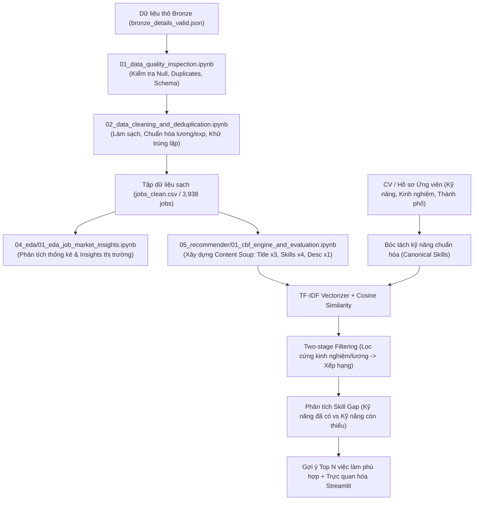

# Jupyter Notebooks — IT Job Market Intelligence 🚀

Thư mục chứa toàn bộ Jupyter Notebooks phục vụ nghiên cứu, phân tích dữ liệu thị trường IT và phát triển **Hệ thống Gợi ý Việc làm Dựa trên Nội dung (Content-Based Recommendation System)**.

---

## 📁 Cấu trúc luồng thực nghiệm chuẩn (Pipeline Flow)

Các notebook được tổ chức thành **5 bước tuần tự** theo chu trình chuẩn của bài toán Khoa học Dữ liệu & Hệ thống Gợi ý:

```text
notebook/
│
├── 01_crawling/                                 # [Bước 0] Thu thập dữ liệu việc làm thực tế
│   ├── crawl_data.ipynb                         → Thu thập đa nguồn (TopCV, TopDev, VietnamWorks)
│   ├── crawl_topdev.ipynb                       → Thử nghiệm crawler riêng TopDev (HTML Parser)
│   └── crawl_vietnamworks.ipynb                 → Thử nghiệm crawler riêng VietnamWorks (REST API)
│
├── 02_data_pipeline/                            # [Bước 1, 2 & 3] Data Quality & Làm sạch dữ liệu
│   ├── 01_data_quality_inspection.ipynb         → [BƯỚC 1 & 2]: Lấy dữ liệu cần thiết + Kiểm tra Schema, Null, Duplicates
│   ├── 02_data_cleaning_and_deduplication.ipynb → [BƯỚC 3]: 13 công đoạn làm sạch, chuẩn hóa kỹ năng, lương, exp & Khử trùng lặp
│   └── 03_view_history_quality_metrics.ipynb    → Theo dõi lịch sử và biến động chỉ số chất lượng dữ liệu
│
├── 03_nlp_embeddings/                           # [Chuyên đề NLP] Trích xuất thực thể & Vector ngữ nghĩa
│   ├── 01_nlp_skill_extraction.ipynb            → Chuẩn hóa chức danh, Regex-NER bóc tách kỹ năng, ma trận đồng xuất hiện
│   └── 02_semantic_embedding_experiment.ipynb  → Thử nghiệm SentenceTransformer (384d) biểu diễn ngữ nghĩa bài đăng
│
├── 04_eda/                                      # [Khám phá thị trường] Exploratory Data Analysis
│   └── 01_eda_job_market_insights.ipynb         → Phân tích phân bố lương IT, số năm kinh nghiệm, địa lý và top tech stacks
│
├── 05_recommender/                              # [Bước 4] Hệ thống gợi ý việc làm trọng tâm
│   └── 01_cbf_engine_and_evaluation.ipynb       → Mô hình Content-Based (Content Soup + TF-IDF + Cosine Sim + Evaluation)
│
└── _archive/                                    # [Lưu trữ] Các thực nghiệm kiểm tra DB hoặc giai đoạn sau
    ├── silver_tables/                           → 9 notebook kiểm tra chi tiết các bảng SQL Database
    ├── collaborative_filtering_experiment.ipynb
    └── true_hybrid_recommender_experiment.ipynb
```

---

## 💡 Luồng hoạt động của Hệ Thống Gợi Ý (Content-Based Recommender)



---

## 🚀 Hướng dẫn chạy thử nghiệm

1. **Kích hoạt môi trường ảo**:
   ```powershell
   .\.venv\Scripts\Activate.ps1
   ```
2. **Khởi chạy Jupyter Lab**:
   ```powershell
   jupyter lab
   ```
3. **Thứ tự thực hiện khuyến nghị**:
   - `02_data_pipeline/01_data_quality_inspection.ipynb`: Đánh giá chất lượng dữ liệu thô (Missing, Duplicates).
   - `02_data_pipeline/02_data_cleaning_and_deduplication.ipynb`: Thực hiện quy trình làm sạch & khử trùng lặp để sinh ra `jobs_clean.csv`.
   - `04_eda/01_eda_job_market_insights.ipynb`: Trực quan hóa thị trường tuyển dụng.
   - `05_recommender/01_cbf_engine_and_evaluation.ipynb`: Chạy thuật toán gợi ý và kiểm tra độ chính xác (Precision, Recall).
4. **Khởi chạy ứng dụng Web Demo (Streamlit)**:
   ```powershell
   streamlit run app/Home.py
   ```
