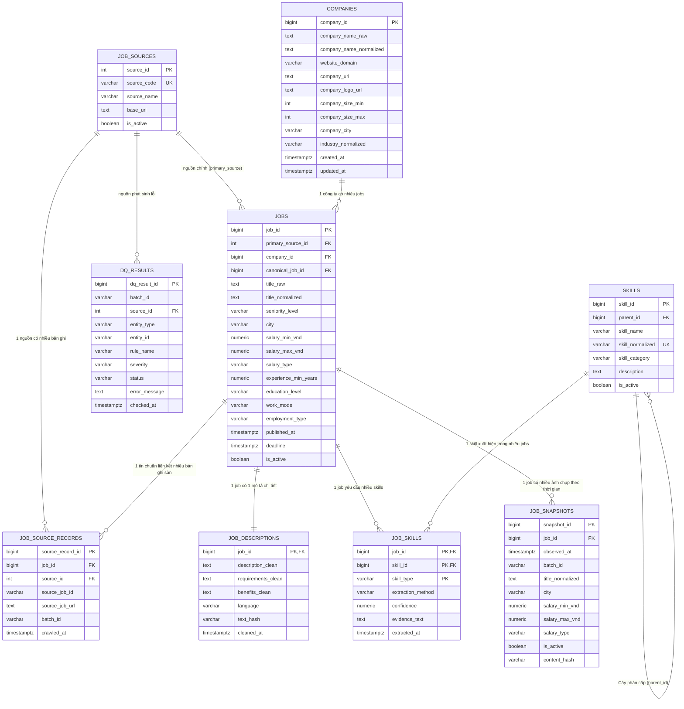

# 🏛️ Thiết Kế Cơ Sở Dữ Liệu Tầng Silver (PostgreSQL Data Warehouse)

Tài liệu này mô tả chi tiết kiến trúc cơ sở dữ liệu **Tầng Silver (Cleaned, Normalized & Governed Layer)** của dự án **IT Job Market Intelligence**, được tối ưu cho hệ quản trị cơ sở dữ liệu quan hệ **PostgreSQL**.

Mô hình được xây dựng theo tiêu chuẩn **Enterprise Data Architecture (3NF + Dimensional Modeling + Data Observability)**, gồm 9 bảng được chia thành 2 phân vùng rõ rệt:
1. **Phân vùng Nghiệp vụ & AI (Core Business & AI Entities)**: Quản lý thực thể việc làm chuẩn (Golden Records), công ty, mô tả NLP và kỹ năng.
2. **Phân vùng Kỹ nghệ Dữ liệu (Data Engineering & Observability)**: Quản lý đa nguồn thu thập (Multi-source Lineage), lịch sử biến động theo chuỗi thời gian (Snapshots), và nhật ký kiểm định chất lượng dữ liệu (DQ Audit Log).

---

## 1. Sơ Đồ Thực Thể Quan Hệ Tổng Thể (Entity Relationship Diagram - ERD)



---

## 2. Chi Tiết Các Bảng Dữ Liệu Theo Phân Vùng

### 🅰️ Phân Vùng 1: Thực Thể Nghiệp Vụ Cốt Lõi & AI (Core Business & AI)

#### 1. Bảng `companies` (Dimension Doanh Nghiệp)
* **Mục đích**: Tập trung thông tin công ty, loại bỏ trùng lặp và lưu trữ quy mô, ngành nghề, địa bàn.
* **Cột cốt lõi**:
  * `company_id`: Khóa chính tự tăng (`BIGINT GENERATED ALWAYS AS IDENTITY`).
  * `company_name_normalized`: Tên công ty đã làm sạch tiền tố pháp lý (*Công ty TNHH, Công ty Cổ phần, Tập đoàn...*).
  * `website_domain`: Tên miền website (ví dụ `fpt.com`, `vng.com.vn`) dùng làm **khóa tự nhiên để khử trùng lặp công ty** khi các sàn ghi tên khác nhau.
  * `company_size_min` & `company_size_max`: Quy mô nhân sự tối thiểu/tối đa đã bóc tách số nguyên.
  * `company_city`: Tỉnh/thành phố đặt trụ sở chính.

#### 2. Bảng `jobs` (Core Fact - Bản Ghi Chuẩn Golden Record)
* **Mục đích**: Bản ghi việc làm chuẩn hóa duy nhất đại diện cho công việc thực tế, độc lập với các sàn cào được.
* **Cột cốt lõi**:
  * `job_id`: Khóa chính nội bộ hệ thống.
  * `company_id`: Khóa ngoại liên kết tới bảng `companies`.
  * `seniority_level`: Cấp bậc phân tích (*Intern, Fresher, Junior, Middle, Senior, Lead, Manager, Director*).
  * `salary_min_vnd` & `salary_max_vnd`: Mức lương tối thiểu và tối đa **đã quy đổi thống nhất về VNĐ/tháng** (đã tính tỷ giá USD) để vẽ biểu đồ và lọc khoảng lương trên Dashboard.
  * `salary_type`: Phân loại lương (*range, fixed, min_only, max_only, negotiable, undisclosed*).
  * `experience_min_years` & `experience_max_years`: Số năm kinh nghiệm tối thiểu/tối đa.
  * `work_mode`: Hình thức làm việc (*Onsite, Hybrid, Remote*).
  * `is_active`: Trạng thái tin còn hoạt động trên thị trường.

#### 3. Bảng `job_descriptions` (Heavy Text & NLP Prep)
* **Mục đích**: Tách các cột văn bản dài (*overview, responsibilities, requirements, benefits*) chiếm 80-90% dung lượng byte ra khỏi bảng `jobs`, giúp bảng `jobs` siêu nhẹ khi truy vấn nghiệp vụ.
* **Cột cốt lõi**:
  * `job_id`: Khóa chính và khóa ngoại quan hệ 1-1 với bảng `jobs`.
  * `description_clean`, `requirements_clean`, `benefits_clean`: Văn bản đã loại bỏ HTML và chuẩn hóa bullet points.
  * `language`: Ngôn ngữ của JD (`vi`: Tiếng Việt, `en`: Tiếng Anh, `vi-en`: Song ngữ) phục vụ chọn mô hình NLP và Tokenizer tương ứng.
  * `text_hash`: Mã băm SHA256 nhận diện tin có bị sửa đổi nội dung giữa các lần crawl hay không.

#### 4. Bảng `skills` (Master Skills Dimension)
* **Mục đích**: Danh mục kỹ năng CNTT chuẩn hóa dùng chung toàn hệ thống, tránh phân mảnh từ khóa (như *Python, python, Python3*).
* **Cột cốt lõi**:
  * `skill_id`: Khóa chính kỹ năng.
  * `skill_name`: Tên kỹ năng hiển thị (*Python, React, AWS, Docker*).
  * `skill_normalized`: Tên viết thường duy nhất (*python, react, aws, docker*).
  * `skill_category`: Nhóm kỹ năng (*Programming Language, Framework / Library, Database, Cloud & DevOps, AI / Machine Learning, Testing & QA...*).
  * `parent_id`: Khóa tự tham chiếu tạo cây phân cấp kỹ năng (ví dụ: `FastAPI` ➔ `parent_id` trỏ về `Python`).

#### 5. Bảng `job_skills` (Bridge Table Quan Hệ N - N)
* **Mục đích**: Bảng liên kết nhiều-nhiều (N - N) giữa tin tuyển dụng và kỹ năng yêu cầu.
* **Cột cốt lõi**:
  * Khóa chính ghép: `PRIMARY KEY (job_id, skill_id, skill_type)`.
  * `skill_type`: Phân loại kỹ năng (*required: Bắt buộc, preferred: Ưu tiên / Điểm cộng, mentioned: Nhắc tới trong JD*).
  * `extraction_method`: Phương thức trích xuất (*tag_direct: Tag sàn, rule_based: Regex văn bản, nlp: Mô hình AI*).
  * `confidence`: Độ tin cậy của kết quả trích xuất (từ 0.000 đến 1.000).
  * `evidence_text`: Đoạn văn bản chứa từ khóa làm bằng chứng ngữ cảnh (**Explainable AI** cho hệ thống gợi ý việc làm).

---

### 🅱️ Phân Vùng 2: Kỹ Nghệ Dữ Liệu & Quan Sát (Data Engineering & Observability)

#### 6. Bảng `job_sources` (Danh Mục Nền Tảng Tuyển Dụng)
* **Mục đích**: Quản lý các website/sàn tuyển dụng được thu thập vào hệ thống.
* **Cột cốt lõi**:
  * `source_id`: Khóa chính tự tăng.
  * `source_code`: Mã sàn viết thường duy nhất (`topcv`, `topdev`, `vietnamworks`).
  * `source_name`: Tên sàn đầy đủ.
  * `base_url`: Địa chỉ trang chủ của sàn.
  * `is_active`: Trạng thái nguồn còn được kích hoạt cào hay không.

#### 7. Bảng `job_source_records` (Mapping Đa Nguồn & Truy Vết Nguồn Gốc)
* **Mục đích**: Liên kết một công việc chuẩn (Golden Record) với các bài đăng gốc trên từng website cào được.
* **Giá trị kiến trúc**:
  * Nếu một công ty đăng tuyển cùng 1 vị trí lên cả TopCV và VietnamWorks: Hệ thống chỉ tạo **1 bản ghi trong bảng `jobs`**, nhưng tạo **2 dòng trong `job_source_records`**.
  * Bảng này giúp giải quyết dứt điểm vấn đề trùng lặp liên sàn (Cross-portal deduplication).
* **Ràng buộc**: `UNIQUE (source_id, source_job_id)` đảm bảo mỗi bài đăng trên một sàn chỉ được lưu duy nhất một lần.

#### 8. Bảng `job_snapshots` (Lịch Sử Biến Động Chuỗi Thời Gian)
* **Mục đích**: Bảng chụp ảnh định kỳ (Periodic Snapshot Fact Table) lưu lại trạng thái của tin tại các thời điểm crawl khác nhau.
* **Giá trị phân tích**:
  * Trả lời các câu hỏi xu hướng thị trường: *Mức lương vị trí này có tăng theo thời gian không? Một tin tuyển dụng mở bao nhiêu ngày thì đóng (Time-to-Hire)? Biến động nhu cầu tuyển dụng theo từng tháng.*
  * `content_hash`: Giúp nhận diện nhà tuyển dụng có vừa cập nhật lại mô tả công việc hay không.

#### 9. Bảng `dq_results` (Nhật Ký Kiểm Định Chất Lượng Dữ Liệu - Data Quality Audit)
* **Mục đích**: Đưa toàn bộ kết quả kiểm định chất lượng dữ liệu (Data Quality) vào cơ sở dữ liệu để quan sát (Data Observability).
* **Giá trị vận hành**:
  * Giúp đội ngũ kỹ thuật dựng Dashboard giám sát (trên Grafana / Metabase):
    * Sàn nào có tỷ lệ dữ liệu rác cao nhất?
    * Các quy tắc nào hay bị vi phạm nhất (`MISSING_TITLE`, `INVALID_SALARY_RANGE`...)?
    * Bao nhiêu bản ghi bị chuyển vào vùng cách ly (Quarantine)?
  * `severity`: Phân loại mức độ nghiêm trọng (`CRITICAL`, `ERROR`, `WARNING`, `INFO`).

---

## 3. Hướng Dẫn Triển Khai Vào PostgreSQL

### Bước 1: Khởi tạo Schema
Bạn chỉ cần chạy tệp [sql/schema_silver.sql](schema_silver.sql) trực tiếp trên PostgreSQL:

```bash
psql -U postgres -d it_job_market -f sql/schema_silver.sql
```

Hoặc thực thi qua DBeaver, pgAdmin bằng cách mở file `sql/schema_silver.sql` và nhấn `Execute (F5)`.

---

## 4. Các Câu Lệnh Truy Vấn SQL Mẫu (Analytical Queries)

### Query 1: Top 15 Kỹ Năng Được Tuyển Dụng Nhiều Nhất
```sql
SELECT 
    s.skill_name,
    s.skill_category,
    COUNT(js.job_id) AS total_jobs,
    ROUND(COUNT(js.job_id) * 100.0 / (SELECT COUNT(*) FROM jobs WHERE is_active = TRUE), 2) AS demand_percentage
FROM skills s
JOIN job_skills js ON s.skill_id = js.skill_id
JOIN jobs j ON js.job_id = j.job_id
WHERE j.is_active = TRUE
GROUP BY s.skill_name, s.skill_category
ORDER BY total_jobs DESC
LIMIT 15;
```

### Query 2: Mức Lương Trung Vị & Trung Bình Theo Cấp Bậc (Seniority)
```sql
SELECT 
    seniority_level,
    COUNT(job_id) AS job_count,
    ROUND(AVG(salary_min_vnd) / 1000000, 1) AS avg_min_salary_million,
    ROUND(AVG(salary_max_vnd) / 1000000, 1) AS avg_max_salary_million
FROM jobs
WHERE salary_min_vnd IS NOT NULL 
  AND salary_max_vnd IS NOT NULL
  AND is_active = TRUE
GROUP BY seniority_level
ORDER BY avg_max_salary_million DESC;
```

### Query 3: Báo Cáo Chất Lượng Dữ Liệu (DQ Error Breakdown Theo Sàn)
```sql
SELECT 
    js.source_name,
    dq.rule_name,
    dq.severity,
    COUNT(*) AS violation_count
FROM dq_results dq
LEFT JOIN job_sources js ON dq.source_id = js.source_id
WHERE dq.status = 'FAILED'
GROUP BY js.source_name, dq.rule_name, dq.severity
ORDER BY violation_count DESC;
```

### Query 4: Phân Tích Vòng Đời Tin Tuyển Dụng (Time-to-Hire từ Snapshots)
```sql
SELECT 
    j.job_id,
    j.title_normalized,
    c.company_name_normalized,
    MIN(s.observed_at) AS first_observed,
    MAX(s.observed_at) AS last_observed,
    ROUND(EXTRACT(EPOCH FROM (MAX(s.observed_at) - MIN(s.observed_at))) / 86400, 1) AS active_days
FROM job_snapshots s
JOIN jobs j ON s.job_id = j.job_id
JOIN companies c ON j.company_id = c.company_id
GROUP BY j.job_id, j.title_normalized, c.company_name_normalized
HAVING COUNT(s.snapshot_id) > 1
ORDER BY active_days DESC;
```
