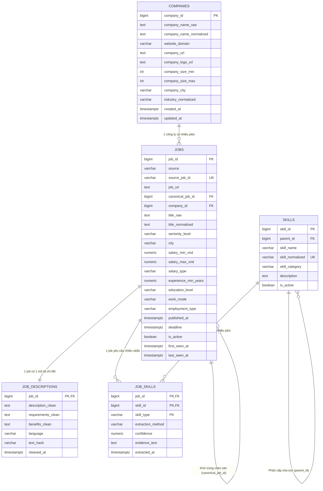

# 🏛️ Thiết Kế Cơ Sở Dữ Liệu Tầng Silver (PostgreSQL Data Warehouse)

Tài liệu này mô tả chi tiết kiến trúc cơ sở dữ liệu **Tầng Silver (Cleaned & Normalized Layer)** của dự án **IT Job Market Intelligence**, được tối ưu cho cơ sở dữ liệu quan hệ **PostgreSQL**.

Mô hình được xây dựng theo tiêu chuẩn **3NF kết hợp Dimensional Modeling**, giúp:
1. **Loại bỏ dư thừa dữ liệu**: Tách thông tin công ty và kỹ năng thành các bảng Dimension riêng.
2. **Tối ưu hóa hiệu năng truy vấn**: Tách văn bản mô tả dài (JD) ra khỏi bảng việc làm cốt lõi để bảng `jobs` siêu nhẹ khi phục vụ lọc và Dashboard.
3. **Sẵn sàng cho AI & Recommendation**: Lưu trữ vết trích xuất kỹ năng (`evidence_text`, `confidence`) phục vụ giải thích gợi ý (Explainable AI) và hỗ trợ mở rộng vector search.

---

## 1. Sơ Đồ Thực Thể Quan Hệ (Entity Relationship Diagram - ERD)



---

## 2. Chi Tiết Các Bảng Dữ Liệu

### 🏢 Bảng 1 — `companies` (Dimension Công Ty)
* **Mục đích**: Lưu thông tin doanh nghiệp tập trung, tránh lặp lại tên, logo, địa chỉ và quy mô hàng nghìn lần trong các tin tuyển dụng.
* **Các trường cốt lõi**:
  * `company_id`: Khóa chính tự tăng (`BIGINT GENERATED ALWAYS AS IDENTITY`).
  * `company_name_normalized`: Tên công ty đã loại bỏ các tiền tố pháp lý (*Công ty TNHH, Công ty Cổ phần, Chi nhánh, Tập đoàn...*).
  * `website_domain`: Tên miền website (ví dụ `fpt.com`, `vng.com.vn`). Đây là **chìa khóa vàng để khử trùng lặp công ty** khi các sàn ghi tên khác nhau.
  * `company_size_min` & `company_size_max`: Quy mô nhân sự đã bóc tách số (ví dụ: `100 - 499`).
  * `company_city`: Tỉnh / Thành phố đặt trụ sở chính.

---

### 💼 Bảng 2 — `jobs` (Core Fact Tin Tuyển Dụng)
* **Mục đích**: Bảng trung tâm của toàn bộ hệ thống, chứa các thông tin phân tích thường dùng nhất (lương, kinh nghiệm, cấp bậc, hình thức làm việc).
* **Các trường cốt lõi**:
  * `job_id`: Khóa chính nội bộ hệ thống.
  * `source` & `source_job_id`: Định danh nguồn (`topcv`, `topdev`, `vietnamworks`) và mã tin gốc. Có ràng buộc `UNIQUE (source, source_job_id)` đảm bảo tính **Idempotent** khi nạp dữ liệu.
  * `job_url`: Đường dẫn trực tiếp tới bài đăng tuyển dụng để ứng viên ứng tuyển.
  * `canonical_job_id`: Khóa tự tham chiếu trỏ tới `job_id` gốc nếu phát hiện công việc này được đăng chéo trên sàn khác (Cross-Portal Deduplication).
  * `seniority_level`: Cấp bậc chuyên môn (*Intern, Fresher, Junior, Middle, Senior, Lead, Manager, Director*).
  * `salary_min_vnd` & `salary_max_vnd`: Mức lương tối thiểu và tối đa **đã quy đổi thống nhất về đơn vị VNĐ/tháng** (tỷ giá USD đã được tính toán) để phục vụ lọc khoảng lương trên Dashboard.
  * `salary_type`: Phân loại mức lương (*range, fixed, min_only, max_only, negotiable, undisclosed*).
  * `experience_min_years` & `experience_max_years`: Số năm kinh nghiệm tối thiểu/tối đa.
  * `work_mode`: Hình thức làm việc (*Onsite, Hybrid, Remote*).
  * `is_active`: Trạng thái tin còn hoạt động trên thị trường.

---

### 📄 Bảng 3 — `job_descriptions` (Văn Bản Dài & Chuẩn Bị NLP)
* **Mục đích**: Tách các cột văn bản dài (*overview, responsibilities, requirements, benefits*) chiếm 80-90% dung lượng byte ra khỏi bảng `jobs`, giúp bảng `jobs` siêu nhẹ khi truy vấn.
* **Các trường cốt lõi**:
  * `job_id`: Khóa chính đồng thời là khóa ngoại quan hệ 1-1 với `jobs`.
  * `description_clean`, `requirements_clean`, `benefits_clean`: Văn bản đã loại bỏ thẻ HTML rác và chuẩn hóa ký tự đầu dòng.
  * `language`: Ngôn ngữ của JD (`vi`: Tiếng Việt, `en`: Tiếng Anh, `vi-en`: Song ngữ) giúp chọn đúng mô hình NLP và bộ tách từ (Tokenizer).
  * `text_hash`: Mã băm SHA256 để phát hiện nhanh tin có bị sửa đổi nội dung giữa các lần crawl hay không.

---

### 📚 Bảng 4 — `skills` (Master Skills Dimension)
* **Mục đích**: Danh mục kỹ năng CNTT chuẩn hóa dùng chung toàn hệ thống, tránh phân mảnh từ khóa (như *Python, python, Python3*).
* **Các trường cốt lõi**:
  * `skill_id`: Khóa chính kỹ năng.
  * `skill_name`: Tên kỹ năng hiển thị (*Python, React, AWS, Docker*).
  * `skill_normalized`: Tên viết thường duy nhất (*python, react, aws, docker*).
  * `skill_category`: Nhóm kỹ năng (*Programming Language, Framework / Library, Database, Cloud & DevOps, AI / Machine Learning, Testing & QA...*).
  * `parent_id`: Khóa tự tham chiếu tạo cây phân cấp kỹ năng (ví dụ: `FastAPI` ➔ `parent_id` trỏ về `Python`).

---

### 🔗 Bảng 5 — `job_skills` (Bridge Table Quan Hệ N - N)
* **Mục đích**: Bảng liên kết nhiều-nhiều (N - N) giữa tin tuyển dụng và kỹ năng yêu cầu.
* **Các trường cốt lõi**:
  * Khóa chính ghép: `PRIMARY KEY (job_id, skill_id, skill_type)`.
  * `skill_type`: Phân loại kỹ năng (*required: Bắt buộc, preferred: Ưu tiên / Điểm cộng, mentioned: Nhắc tới trong JD*).
  * `extraction_method`: Phương thức trích xuất (*tag_direct: Tag sàn, rule_based: Regex văn bản, nlp: Mô hình AI*).
  * `confidence`: Độ tin cậy của kết quả trích xuất (từ 0.000 đến 1.000).
  * `evidence_text`: Đoạn văn bản chứa từ khóa làm bằng chứng ngữ cảnh (**Explainable AI** cho hệ thống gợi ý việc làm).

---

## 3. Hướng Dẫn Triển Khai Vào PostgreSQL

### Bước 1: Khởi tạo Schema
Bạn chỉ cần chạy tệp [sql/schema_silver.sql](schema_silver.sql) trực tiếp trên PostgreSQL:

```bash
psql -U postgres -d it_job_market -f sql/schema_silver.sql
```

Hoặc thực thi qua DBeaver, pgAdmin bằng cách mở file `sql/schema_silver.sql` và nhấn `Execute (F5)`.

---

## 4. Các Câu Lệnh Truy Vấn SQL Mẫu (Analytical Queries)

### Query 1: Top 15 Kỹ Năng Được Tuyển Dụng Nhiều Nhất
```sql
SELECT 
    s.skill_name,
    s.skill_category,
    COUNT(js.job_id) AS total_jobs,
    ROUND(COUNT(js.job_id) * 100.0 / (SELECT COUNT(*) FROM jobs WHERE is_active = TRUE), 2) AS demand_percentage
FROM skills s
JOIN job_skills js ON s.skill_id = js.skill_id
JOIN jobs j ON js.job_id = j.job_id
WHERE j.is_active = TRUE
GROUP BY s.skill_name, s.skill_category
ORDER BY total_jobs DESC
LIMIT 15;
```

### Query 2: Mức Lương Trung Vị & Trung Bình Theo Cấp Bậc (Seniority)
```sql
SELECT 
    seniority_level,
    COUNT(job_id) AS job_count,
    ROUND(AVG(salary_min_vnd) / 1000000, 1) AS avg_min_salary_million,
    ROUND(AVG(salary_max_vnd) / 1000000, 1) AS avg_max_salary_million
FROM jobs
WHERE salary_min_vnd IS NOT NULL 
  AND salary_max_vnd IS NOT NULL
  AND is_active = TRUE
GROUP BY seniority_level
ORDER BY avg_max_salary_million DESC;
```

### Query 3: Top 10 Doanh Nghiệp Có Nhu Cầu Tuyển Dụng Lớn Nhất
```sql
SELECT 
    c.company_name_normalized,
    c.company_city,
    c.company_size_raw,
    COUNT(j.job_id) AS open_positions
FROM companies c
JOIN jobs j ON c.company_id = j.company_id
WHERE j.is_active = TRUE
GROUP BY c.company_id, c.company_name_normalized, c.company_city, c.company_size_raw
ORDER BY open_positions DESC
LIMIT 10;
```
