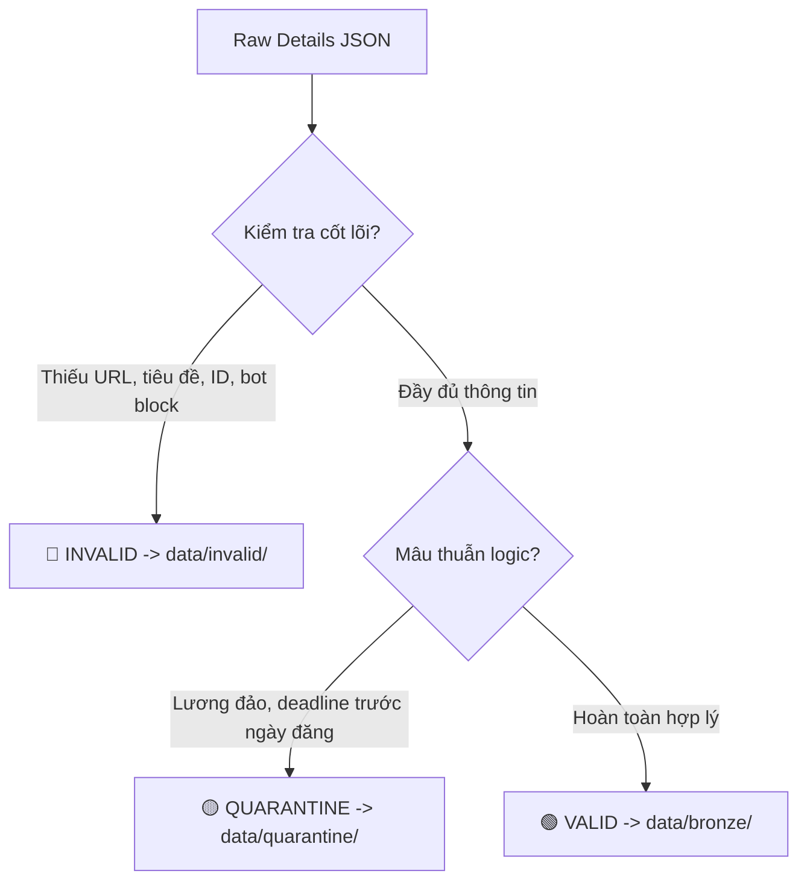

# 🛡️ Data Quality Module (`src/quality`)

Module chịu trách nhiệm kiểm định chất lượng dữ liệu (Data Quality Gate) và tự động phân luồng bản ghi thô từ `data/raw/` thành 3 luồng riêng biệt:
1. 🟢 **VALID (Hợp Lệ)**: Dữ liệu sạch, sẵn sàng chuyển vào tầng Bronze (`data/bronze/`).
2. 🟡 **QUARANTINE (Khu Cách Ly)**: Dữ liệu có giá trị nhưng chứa bất thường logic (lương đảo, ngày tháng bất hợp lý) -> Giữ lại để xử lý/chuẩn hóa ở tầng Silver.
3. 🔴 **INVALID (Rác / Hỏng Nặng)**: Dữ liệu thiếu URL, rỗng tiêu đề hoặc bị chặn bot -> Loại bỏ khỏi luồng chính, lưu file lỗi để kiểm tra crawler.

---

## 1. Cấu Trúc Thư Mục

```
src/quality/
├── __init__.py           # Export QualityValidator, rules và các mã lỗi chuẩn hóa
├── rules.py              # Định nghĩa bộ quy tắc kiểm định 3 luồng (Valid, Quarantine, Invalid)
└── validator.py          # Động cơ kiểm tra, gắn metadata _dq_* và lưu trữ vào các tầng thư mục
```

---

## 2. Tiêu Chí Phân Luồng Chi Tiết



### A. 🔴 Luồng INVALID (Dữ liệu rác / Hỏng nặng)
Các bản ghi vi phạm những điều kiện tiên quyết không thể khôi phục:
- `ERR_MISSING_JOB_URL`: URL rỗng hoặc không đúng định dạng HTTP/HTTPS.
- `ERR_MISSING_JOB_ID`: Cả `source_job_id` và `detail_id` đều bị rỗng.
- `ERR_MISSING_TITLE`: Tiêu đề rỗng hoặc ít hơn 2 ký tự.
- `ERR_MISSING_SOURCE`: Nguồn tuyển dụng không nằm trong danh sách hỗ trợ (`topcv`, `topdev`, `vietnamworks`).
- `ERR_CONTENT_TOO_SHORT`: Tổng mô tả (`overview` + `responsibilities` + `requirements` + `benefits`) $< 100$ ký tự (bị bot chặn, captcha, bài đăng trắng).

### B. 🟡 Luồng QUARANTINE (Khu cách ly - Logic Anomalies)
Bản ghi có đầy đủ thông tin định danh và mô tả tốt, nhưng chứa mâu thuẫn về mặt logic giá trị:
- **Lương (Salary Sanity)**:
  * `ERR_SALARY_INVERTED`: Lương tối thiểu lớn hơn lương tối đa (ví dụ: `40 - 20 triệu`).
  * `ERR_SALARY_NEGATIVE`: Xuất hiện số âm trong khoảng lương.
  * `ERR_SALARY_OUTLIER`: Mức lương dị thường vượt quá ngưỡng thực tế ($> 1$ tỷ VND hoặc $> \$50,000$ USD/tháng).
- **Hạn nộp & Ngày đăng (Date Sanity)**:
  * `ERR_DATE_DEADLINE_BEFORE_PUBLISHED`: Hạn nộp hồ sơ trước ngày đăng tin.
  * `ERR_DATE_FAR_PAST`: Năm đăng hoặc hạn nộp quá xa trong quá khứ ($< 2020$).
  * `ERR_DATE_MALFORMED`: Chuỗi ngày tháng bị lỗi cú pháp không thể parse.

### C. 🟢 Luồng VALID (Đạt chuẩn chất lượng)
- Vượt qua toàn bộ kiểm tra Invalid và không dính bất kỳ mã lỗi Quarantine nào.
- Được gắn nhãn `_dq_status: "valid"`, `_dq_errors: []` và sẵn sàng lưu vào `data/bronze/`.

---

## 3. Cách Sử Dụng CLI (`main_quality.py`)

Chạy kiểm định và xem thống kê phân luồng (Dry-Run, không ghi đè dữ liệu):
```bash
python main_quality.py
```

Chỉ kiểm định ngày cào mới nhất:
```bash
python main_quality.py --latest
```

Lưu cả 3 luồng vào đúng các thư mục đích (`data/bronze/`, `data/quarantine/`, `data/invalid/`):
```bash
python main_quality.py --save-all
```

Chỉ lưu luồng Hợp Lệ vào tầng Bronze:
```bash
python main_quality.py --save-bronze
```

Chỉ kiểm định một sàn cụ thể:
```bash
python main_quality.py --source topcv
```

---

## 4. Kiểm Thử (Unit Tests)

Bộ unit test kiểm tra toàn diện cả 3 luồng và chức năng lưu trữ:
```bash
pytest tests/unit/test_data_quality.py -v
```
Chạy toàn bộ 24 test cases của dự án:
```bash
pytest tests -v
```
